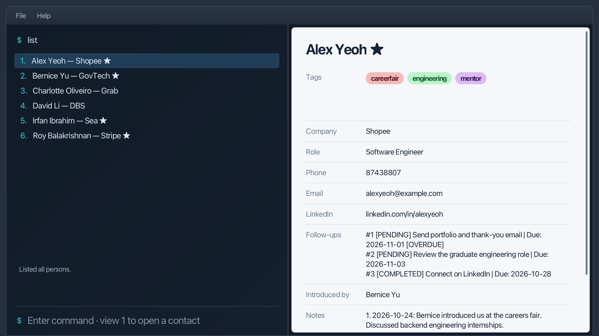

# Astra

**Astra is a contact book for people who network a lot.** Capture each new person you meet in the seconds between conversations, remember what you talked about and what you promised, and pull them up again before you next meet. You type commands; Astra shows the results beside each contact's details.

* **Who it is for:** students and early-career professionals who attend networking events, career fairs and conferences, type fast, and are comfortable with a command line.
* **What it does:**
  * `add`, `edit`, `drop` and `introduce` keep each contact's name, company, role, phone, email, LinkedIn, introducer, events and tags up to date
  * `find` by name (with `/fuzzy` for typos), phone, email, company, role, event or conversation notes, and `filter` by tags
  * `view` everything about a contact, `star` the important ones, and `order` the fields to suit you
  * `log` conversations, and record, review, complete and edit `followup`s with due dates
  * `delete` contacts by index, name, phone or several emails, or `clear` them all, after previewing the change; `undo` the last edit or deletion
  * `alias` your own command shortcuts
  * Saves after every change, keeps your previous data if a save fails, and recovers what it can from a damaged data file

* **Getting started:** see the [User Guide](https://ay2627s1-cs2103-f13-2.github.io/tp/UserGuide.html).
* **For developers:** see the [Developer Guide](https://ay2627s1-cs2103-f13-2.github.io/tp/DeveloperGuide.html).

## Acknowledgements

* This project is based on the AddressBook-Level3 project created by the [SE-EDU initiative](https://se-education.org).
