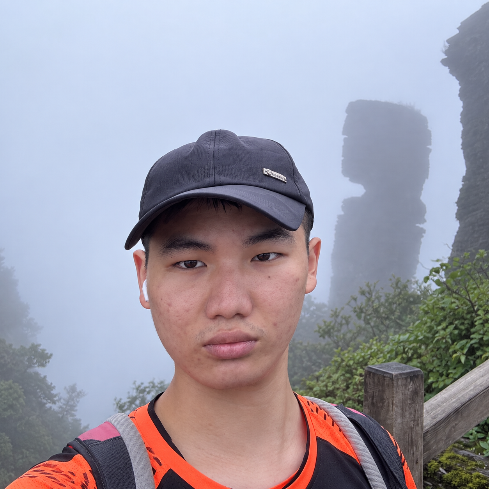
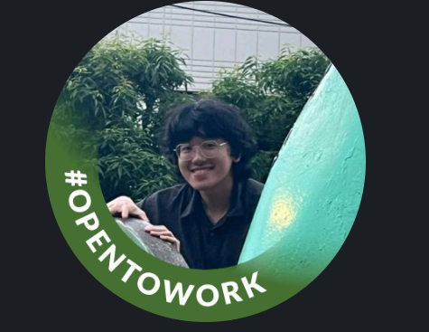

We are a team based in the [School of Computing, National University of Singapore](https://www.comp.nus.edu.sg).

You can reach us through our [issue tracker](https://github.com/AY2627S1-CS2103-F13-2/tp/issues).

## Project team

### Ng Xuan Jin

[[github](https://github.com/ngxuanjin)]

* Role: Project Advisor

### Yuxiang Liu

[[github](https://github.com/Yx0905)]

* Role: Developer
* Responsibilities: Dev Ops + Threading

### Kafka

[[github](http://github.com/Kafka03)]

* Role: Team Lead
* Responsibilities: UI

### Yao Zhu

[[github](https://github.com/Cookiemunchrr)]

* Role: Developer
* Responsibilities: Logic

### Kee Yen Cheng

[[github](https://github.com/KeeYenCheng)]

* Role: Developer
