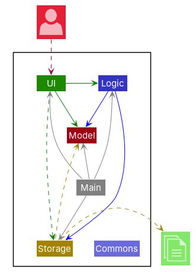
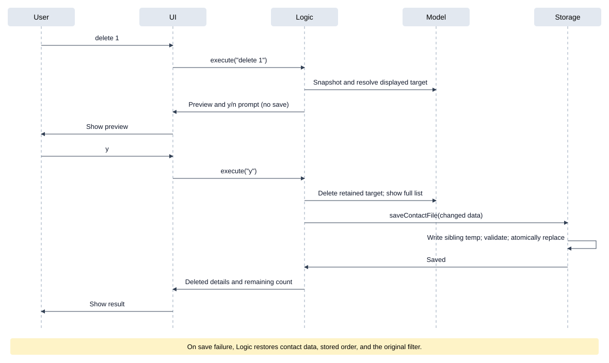
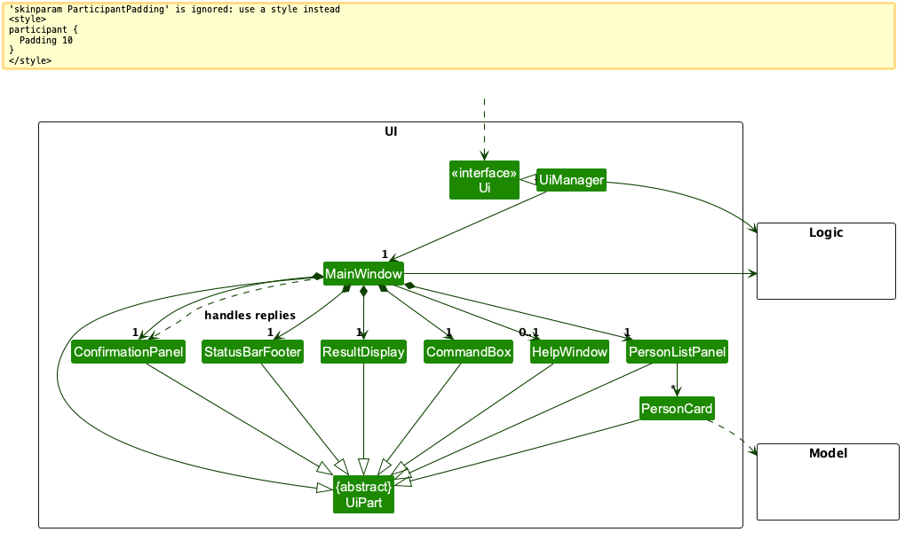
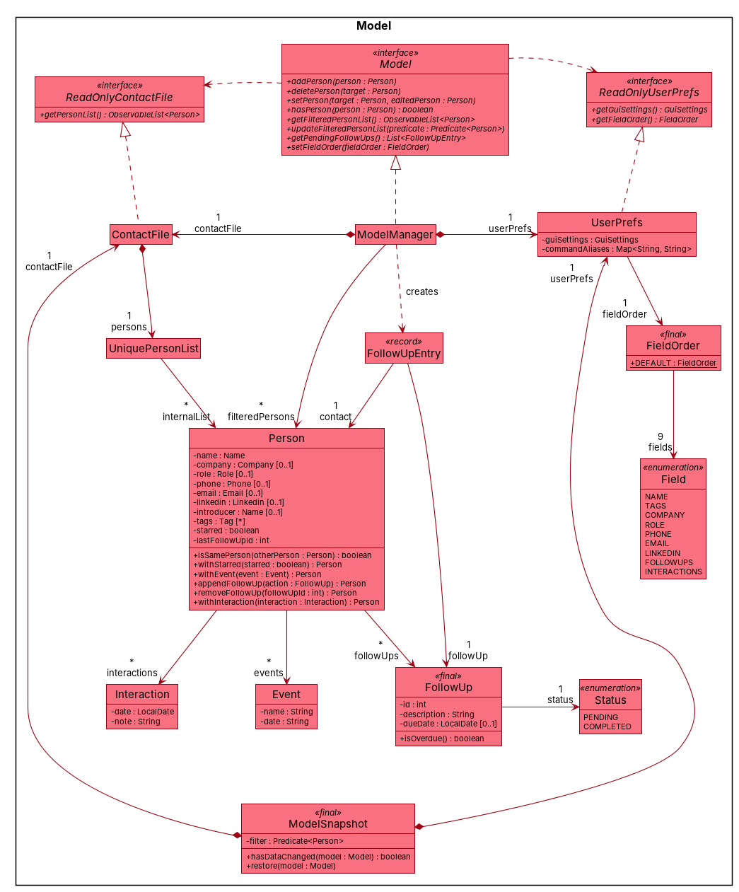
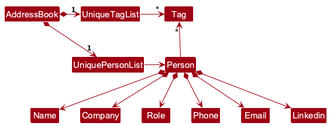
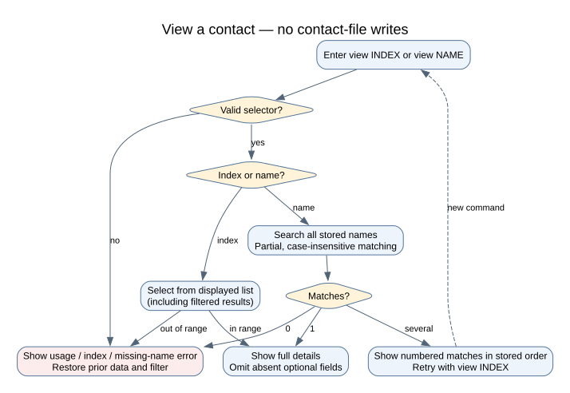
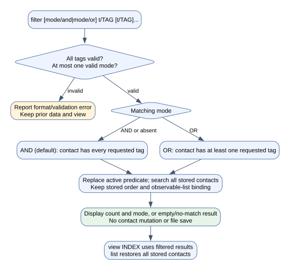
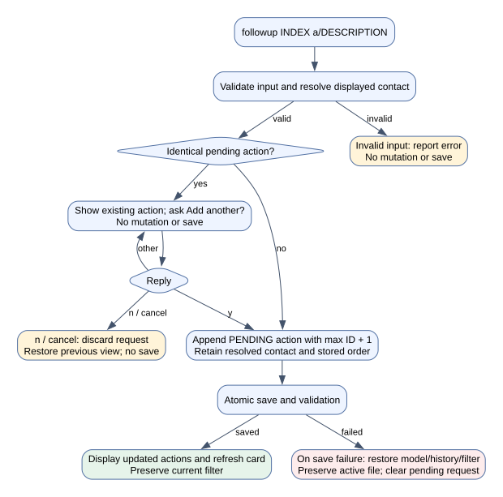
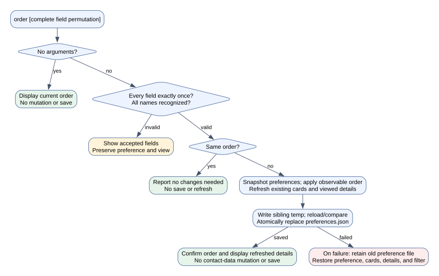

* Table of Contents
{:toc}

--------------------------------------------------------------------------------------------------------------------

## **Acknowledgements**

* _{List the sources of reused or adapted ideas, code, documentation, and third-party libraries here, with links to the originals.}_

--------------------------------------------------------------------------------------------------------------------

## **Setting up, getting started**

Refer to the guide [_Setting up and getting started_](SettingUp.md).

--------------------------------------------------------------------------------------------------------------------

## **Design**

:bulb: **Tip:** The `.puml` files used to create diagrams are in `docs/diagrams`. Refer to the [_PlantUML Tutorial_ at se-edu/guides](https://se-education.org/guides/tutorials/plantUml.html) to learn how to create and edit diagrams.

### Architecture

The ***Architecture Diagram*** given above explains the high-level design of the App.

The following provides a quick overview of the main components and their interactions.

**Main components of the architecture**

**`Main`** (consisting of classes [`Main`](https://github.com/se-edu/addressbook-level3/tree/master/src/main/java/seedu/address/Main.java) and [`MainApp`](https://github.com/se-edu/addressbook-level3/tree/master/src/main/java/seedu/address/MainApp.java)) is in charge of the app launch and shut down.
* At app launch, it initializes the other components in the correct sequence, and connects them up with each other.
* At shut down, it shuts down the other components and invokes cleanup methods where necessary.

The bulk of the app's work is done by the following four components:

* [**`UI`**](#ui-component): The UI of the App.
* [**`Logic`**](#logic-component): The command executor.
* [**`Model`**](#model-component): Holds the data of the App in memory.
* [**`Storage`**](#storage-component): Reads data from, and writes data to, the hard disk.

[**`Commons`**](#common-classes) represents a collection of classes used by multiple other components.

**How the architecture components interact with each other**

The *Sequence Diagram* below shows `delete 1` followed by `y`, including the
preview before mutation and the atomic save after confirmation.

Each of the four main components (also shown in the diagram above),

* defines its *API* in an `interface` with the same name as the Component.
* provides its functionality through a concrete `{Component Name}Manager` class that implements the corresponding API interface.

For example, the `Logic` component defines its API in `Logic.java` and implements it in `LogicManager.java`. Other components interact with a component through its interface rather than its concrete class, preventing them from coupling to that component's implementation, as illustrated in the following partial class diagram.

The sections below give more details of each component.

### UI component

The **API** of this component is specified in [`Ui.java`](https://github.com/se-edu/addressbook-level3/tree/master/src/main/java/seedu/address/ui/Ui.java)

The UI consists of a `MainWindow` and its parts, such as `CommandBox`, `ResultDisplay`, `PersonListPanel`, and `StatusBarFooter`. All of these, including `MainWindow`, inherit from the abstract `UiPart` class, which captures common behavior among classes that represent visible GUI parts.

The `UI` component uses the JavaFX UI framework. The layouts of these UI parts are defined in matching `.fxml` files in `src/main/resources/view`. For example, [`MainWindow.fxml`](https://github.com/se-edu/addressbook-level3/tree/master/src/main/resources/view/MainWindow.fxml) specifies the layout of [`MainWindow`](https://github.com/se-edu/addressbook-level3/tree/master/src/main/java/seedu/address/ui/MainWindow.java).

The `UI` component,

* executes user commands using the `Logic` component.
* listens for changes to `Model` data so that the UI can be updated with the modified data.
* keeps a reference to the `Logic` component, because the `UI` relies on the `Logic` to execute commands.
* depends on some classes in the `Model` component because it displays `Person` objects from the model.

### Logic component

**API** : [`Logic.java`](https://github.com/se-edu/addressbook-level3/tree/master/src/main/java/seedu/address/logic/Logic.java)

Here's a (partial) class diagram of the `Logic` component:

The sequence diagram below shows how Logic resolves `delete 1`, waits for `y`,
then mutates and saves. Parsing is omitted from this diagram.

How the `Logic` component works:

1. When `Logic` is called upon to execute a command, the command is passed to a `ContactFileParser` object, which in turn creates a parser that matches the command (e.g., `DeleteCommandParser`) and uses it to parse the command.
1. This results in a `Command` object (more precisely, an object of one of its subclasses e.g., `DeleteCommand`) which is executed by the `LogicManager`.
1. The command can communicate with the `Model` when it is executed (e.g. to delete a person). 
   Note that although this is shown as a single step in the diagram above for simplicity, the code can require several interactions between the command object and the `Model` to complete the operation.
1. The result of the command execution is encapsulated as a `CommandResult` object which is returned from `Logic`.
1. A result carrying a `PendingRequest` is retained by Logic until the user
   answers or cancels. Replies go to that request before normal command parsing.
   Completed data changes are saved transactionally; read-only results are not.

Here are the other classes in `Logic` (omitted from the class diagram above) that are used for parsing a user command:

How the parsing works:
* When called upon to parse a user command, the `ContactFileParser` class creates an `XYZCommandParser` (`XYZ` is a placeholder for the specific command name, e.g., `AddCommandParser`). The parser uses the other classes shown above to parse the user command and create an `XYZCommand` object (e.g., `AddCommand`). The `ContactFileParser` returns that object as a `Command` object.
* All `XYZCommandParser` classes, such as `AddCommandParser` and `DeleteCommandParser`, implement the `Parser` interface so they can be treated similarly where appropriate, for example during testing.

### Model component
**API** : [`Model.java`](https://github.com/se-edu/addressbook-level3/tree/master/src/main/java/seedu/address/model/Model.java)

The `Model` component,

* stores the contact file data i.e., all `Person` objects (which are contained in a `UniquePersonList` object).
* a `Person` always has a `Name`, and may additionally have a `Company`, `Role`, `Phone`, `Email` and `Linkedin`. Every field other than the name is optional, because a contact met at a networking event is often captured with only the details that were exchanged. Optional fields are exposed as `Optional<...>` so callers must handle an absent value.
* `Person#isSamePerson` retains the legacy identity rule: equal names and equal email presence (both present or both absent). Email values do not participate in that rule. Add/edit separately reject shared normalized phone numbers and case-insensitive email addresses. This differs from the intended phone/email key policy; changing identity requires a separate compatibility decision.
* stores the `Person` objects selected by the current filter, such as search results, in a separate _filtered_ list. It exposes this list as an unmodifiable `ObservableList<Person>` that the UI can observe and bind to, so the UI updates when the list changes.
* stores a `UserPrefs` object that represents the user’s preferences (GUI settings and the global contact field order). This is exposed to the outside as a `ReadOnlyUserPrefs` object.
* does not depend on any of the other three components (as the `Model` represents data entities of the domain, they should make sense on their own without depending on other components)

:information_source: **Note:** The alternative, arguably more object-oriented, design below keeps a unique list of tags in `ContactFile`, and each `Person` references tags from that list. This lets `ContactFile` maintain one `Tag` object per unique tag instead of each `Person` holding its own `Tag` objects. 

### Storage component

**API** : [`Storage.java`](https://github.com/se-edu/addressbook-level3/tree/master/src/main/java/seedu/address/storage/Storage.java)

The `Storage` component,
* can save both contact file data and user preference data in JSON format, and read them back into corresponding objects.
* is implemented by `StorageManager`, which delegates the actual JSON file access to `JsonContactFileStorage` and `JsonUserPrefsStorage` (one class per data file).
* depends on some classes in the `Model` component (because the `Storage` component's job is to save/retrieve objects that belong to the `Model`)

### Common classes

Classes used by multiple components are in the `seedu.address.commons` package.

--------------------------------------------------------------------------------------------------------------------

## **Implementation**

This section describes some noteworthy details on how certain features are implemented.

### Shared contact matching

`NameContainsKeywordsPredicate` supplies the existing contiguous, partial,
case-insensitive name matching used by find, edit, delete, and view.
`PersonNameResolver#resolve` keeps edit and view's numbered-retry behavior.
`PersonNameResolver#findMatches` performs the same full-file lookup without
changing the displayed list; delete uses it before creating a pending request.
Ambiguous delete names display candidates and require a numeric reply followed
by a separate y/n confirmation. A name never implicitly selects the first match.

### Viewing contacts by name or displayed index

`ViewCommandParser` normalizes whitespace and uses `ParserUtil#isIndexInput` to classify the selector.
A numeric first token must form one valid positive index; otherwise the complete input must be a valid
name. Prefix syntax is rejected. `ViewCommand` resolves a name with `PersonNameResolver` and sends a
unique contact to the same `Messages#format` path as index selection, using the saved field order.
Both paths retain the contact in the result so changes to field order immediately refresh viewed details.
Absent optional fields are omitted.
Several matches return the resolver's numbered candidates and a command-specific retry instruction.
There is no pending request or y/n prompt: the next `view INDEX` simply selects from the current list.

Index selection keeps the current filter, while name resolution searches all contacts and replaces the
filter with the matching names. `LogicManager` restores the pre-command snapshot on lookup/parse failure,
including the original dynamic predicate and existing observable-list binding. Successful unique and
ambiguous lookups change no contact data, so the transactional save boundary performs zero writes.
`list` restores the full list. No matching, formatting, or persistence rule is duplicated in the view command.

### Normalized contact keys

Phone matching uses `Phone#matches`, which removes spaces, hyphens, and
parentheses but preserves a leading plus. Equality and hashing use that same
canonical value. Email matching uses `Email#matches` and ignores letter case.
`ContactFieldPredicate`, duplicate checks, delete, and startup recovery share
these comparisons. Missing phone/email values are not shared keys.

### Pending requests and transactional commands

`CommandResult` can carry a `PendingRequest`. `LogicManager` retains it together
with a `ModelSnapshot` captured before the initial command. `ConfirmationRequest`
executes its resolved command only for y. `PersonSelectionRequest` turns a
numbered candidate selection into the next request; it retains contact
references rather than resolving a displayed index again later.

Logic handles n/cancel centrally, restores the pre-request filter, and discards
the request. Invalid replies repeat the current prompt; unrelated commands are
not executed while a reply is pending. A completed or failed confirmed request
clears pending state, so a stale y cannot replay the mutation. UC16 reuses the
shared confirmation API with an "Add another?" question for duplicate pending
actions.

`ModelSnapshot` copies contact contents and retains the original predicate.
Logic compares the completed model with the snapshot and saves only changed
contact data. Queries, ambiguity results, prompts, selections, cancellations,
and no-ops perform no contact-file write. On an exception, data and the original
filter are restored without replacing the observable lists bound to the UI.

`JsonContactFileStorage` serializes to a sibling temporary file, reloads and
compares the candidate, then uses atomic replacement. Failures before
replacement preserve the previous active file. Temporary-file cleanup never
turns an already successful replacement into a reported transaction failure.
No unsafe in-place fallback is used when atomic replacement is unavailable.

### Tag filtering (UC20)

`FilterCommandParser` uses the shared prefix tokenizer with repeated `t/`
values and one optional `mode/`. It validates every tag through
`ParserUtil#parseTags` before executing the command; a missing tag, malformed
value, unsupported mode, or repeated mode cannot change the displayed list.
Whitespace separators are normalized locally because neither valid tag names
nor mode values contain whitespace. Mode values use locale-independent case
folding; prefixes and `Tag` equality remain case-sensitive.

`TagFilterPredicate` copies the requested tags into an immutable non-empty set.
AND uses `containsAll`; OR requires any requested tag to occur in a contact's
tag set. Repeated requested tags are collapsed before matching. The command
replaces the model's active predicate, so it searches the full stored list
rather than intersecting the previous results. JavaFX's existing filtered list
retains stored order and its observable binding; no contact is copied, sorted,
or duplicated for the query.

The result reports a count and mode, or a clear no-match message with an empty
list. `view INDEX` continues to resolve the displayed list, and `list` resets
the predicate. Filtering does not change contact contents, so Logic's existing
transaction change detection performs no contact-file save. Parser failures
restore the previous predicate through the same snapshot boundary.

The user's approved AND/OR behavior extends the PDF's AND-only UC20. AND is
the default, and one mode applies to the entire command. No tag/schema or
contact identity change is needed. The following diagram's editable source
is `docs/diagrams/TagFilterActivityDiagram.dot`.

### Starred status and follow-up integration (UC21)

`Person.withStarred(boolean)` copies every contact field and the complete ordered
follow-up history. Appending a follow-up and editing contact details retain the
starred flag. Strong equality and hashing include both metadata fields, so Logic
saves actual changes and rolls both back together on storage failure. JSON stores
both fields; older files default to unstarred contacts with empty action history.

### Follow-up actions (UC16)

`Person` owns an immutable ordered `List<FollowUp>`. Each action has a positive
ID unique within that contact, a stripped non-blank description, and a
`PENDING` or `COMPLETED` status. IDs are allocated as one greater than the
maximum existing ID, including completed history, rather than the list size or
last element. Existing IDs and order never change; ID exhaustion is rejected
without mutation. This version does not remove actions or implement completion.

`FollowUpCommandParser` requires a positive displayed index and exactly one
`a/` description. Extra prefix-shaped tokens (such as `confirm/yes`) are
rejected instead of being silently stored as description text. Exact trimmed,
case-sensitive description equality defines duplicates, and only pending
actions trigger confirmation. The command retains the resolved contact and
description in the shared request. A later displayed index cannot redirect a
confirmed action; a changed or missing target invalidates the request.

Strong `Person` equality/hash include ordered follow-ups so Logic detects and
saves an action change. Contact identity and phone/email duplicate checks do
not include actions. `EditCommand` carries existing history into the replacement
contact, and `PersonBuilder` preserves history when copying a contact in tests.
Model replacement updates bound cards immediately; cards and full details show
each action's stable ID and status, with no blank action row for empty history.

`JsonAdaptedPerson` defaults a missing/null `followUps` property to an empty
list for old files. `JsonAdaptedFollowUp` validates raw JSON field types,
positive integer IDs, non-blank descriptions, and supported status values;
duplicate IDs and null actions invalidate the entire contact. Startup recovery
uses the same conversion and reports/skips the affected record, preserving its
original bytes in the existing recovery archive. Valid histories retain their
order, status, and IDs through normal saves and recovery. Failed immediate or
confirmed saves restore the original action history, model, and predicate.

The following activity diagram shows the command and transaction boundaries.
Its editable source is `docs/diagrams/FollowUpActivityDiagram.dot`.

### Display-field order (UC26)

`FieldOrder` is an immutable permutation of all eight supported fields. Its
constructor validates field count, case-insensitive names, and uniqueness;
partial orders cannot hide fields. The default matches the original card order
with follow-ups last. `UserPrefs` stores this global value and includes it in
copy/equality/hash. JSON uses a canonical array of lower-case field names in
`fieldOrder`; old preference files without that property retain the default.
Malformed or null orders are rejected by preference loading, using the existing
startup fallback to default preferences.

`OrderCommandParser` accepts a no-argument query or one complete permutation.
`OrderCommand` changes only preferences. A query or unchanged order makes no
mutation and performs no save. `ModelSnapshot` now includes preferences as well
as contact data and the active predicate. Logic detects preference changes
separately from contact changes, saves the corresponding file, and restores the
captured model/predicate on failure. The commands in this delivery change one
persistence domain at a time; ordering never writes the contact file.

`JsonUserPrefsStorage` copies the requested preferences, writes a sibling
temporary file, reloads and compares it, then atomically replaces the active
file. Failed writes, invalid/different/missing candidates, or replacement
failures preserve the old file. Temporary cleanup failure after successful
replacement is logged without reporting a false transaction failure. Startup
and shutdown preference saves also use this path.

The model exposes a read-only observable field order through Logic.
`PersonListPanel` refreshes existing cells when it changes; `PersonCard` arranges
its field nodes in that order. The displayed index stays with the name row.
Absent optional values, empty tags, and empty follow-up lists are invisible and
unmanaged, leaving no field rows behind. Contacts, selection indices, stored
order, active predicates, and observable-list bindings are retained.

`Messages#format(Person, FieldOrder)` formats full details in the same order.
View/add/delete detail output passes the active preference. A view result also
retains the contact as presentation metadata in `CommandResult`, so MainWindow
can refresh the last viewed details immediately without parsing feedback or
re-running view. An order change shows its confirmation and the refreshed
details; an error retains details in the restored order alongside the error.
Other successful commands replace the detail context normally. Preference
rollback notifies observers, returning visible cards/details to the saved order.

The PDF's UC26 summary mentions alphabetical sorting, whereas its detailed
MSS specifies field ordering. This implementation follows the detailed MSS and
the user's explicit saved choice. Contact sorting remains outside UC26.
The editable diagram source is `docs/diagrams/FieldOrderActivityDiagram.dot`.

### \[Proposed\] Undo/redo feature

#### Proposed Implementation

The proposed undo/redo mechanism is facilitated by `VersionedContactFile`. It extends `ContactFile` with an undo/redo history, stored internally as a `contactFileStateList` and `currentStatePointer`. Additionally, it implements the following operations:

* `VersionedContactFile#commit()` — Saves the current contact file state in its history.
* `VersionedContactFile#undo()` — Restores the previous contact file state from its history.
* `VersionedContactFile#redo()` — Restores a previously undone contact file state from its history.

These operations are exposed in the `Model` interface as `Model#commitContactFile()`, `Model#undoContactFile()` and `Model#redoContactFile()` respectively.

Given below is an example usage scenario and how the undo/redo mechanism behaves at each step.

Step 1. The user launches the application for the first time. The `VersionedContactFile` will be initialized with the initial contact file state, and the `currentStatePointer` pointing to that single contact file state.

Step 2. The user executes `delete 5` command to delete the 5th person in the contact file. The `delete` command calls `Model#commitContactFile()`, causing the modified state of the contact file after the `delete 5` command executes to be saved in the `contactFileStateList`, and the `currentStatePointer` is shifted to the newly inserted contact file state.

Step 3. The user executes `add n/David …​` to add a new person. The `add` command also calls `Model#commitContactFile()`, causing another modified contact file state to be saved into the `contactFileStateList`.

:information_source: **Note:** If a command fails its execution, it will not call `Model#commitContactFile()`, so the contact file state will not be saved into the `contactFileStateList`.

Step 4. The user now decides that adding the person was a mistake, and decides to undo that action by executing the `undo` command. The `undo` command will call `Model#undoContactFile()`, which will shift the `currentStatePointer` once to the left, pointing it to the previous contact file state, and restores the contact file to that state.

:information_source: **Note:** If the `currentStatePointer` is at index 0, pointing to the initial ContactFile state, then there are no previous ContactFile states to restore. The `undo` command uses `Model#canUndoContactFile()` to check if this is the case. If so, it will return an error to the user rather
than attempting to perform the undo.

The following sequence diagram shows how an undo operation goes through the `Logic` component:

:information_source: **Note:** The lifeline for `UndoCommand` should end at the destroy marker (X), but due to a limitation of PlantUML, it continues to the end of the diagram.

Similarly, how an undo operation goes through the `Model` component is shown below:

The `redo` command does the opposite — it calls `Model#redoContactFile()`, which shifts the `currentStatePointer` once to the right, pointing to the previously undone state, and restores the contact file to that state.

:information_source: **Note:** If the `currentStatePointer` is at index `contactFileStateList.size() - 1`, pointing to the latest contact file state, then there are no undone ContactFile states to restore. The `redo` command uses `Model#canRedoContactFile()` to check if this is the case. If so, it will return an error to the user rather than attempting to perform the redo.

Step 5. The user then decides to execute the command `list`. Commands that do not modify the contact file, such as `list`, will usually not call `Model#commitContactFile()`, `Model#undoContactFile()` or `Model#redoContactFile()`. Thus, the `contactFileStateList` remains unchanged.

Step 6. The user executes `clear`, which calls `Model#commitContactFile()`. Since the `currentStatePointer` is not pointing at the end of the `contactFileStateList`, all contact file states after the `currentStatePointer` will be purged. Reason: It no longer makes sense to redo the `add n/David …​` command. This is the behavior that most modern desktop applications follow.

The following activity diagram summarizes what happens when a user executes a new command:

#### Design considerations:

**Aspect: How undo & redo execute:**

* **Alternative 1 (current choice):** Saves the entire contact file.
  * Pros: Easy to implement.
  * Cons: May have performance issues in terms of memory usage.

* **Alternative 2:** Individual command knows how to undo/redo by
  itself.
  * Pros: Will use less memory (e.g. for `delete`, just save the person being deleted).
  * Cons: We must ensure that the implementation of each individual command is correct.

_{more aspects and alternatives to be added}_

### \[Proposed\] Data archiving

_{Explain here how the data archiving feature will be implemented}_

--------------------------------------------------------------------------------------------------------------------

## **Documentation, logging, testing, dev-ops**

* [Documentation guide](Documentation.md)
* [Testing guide](Testing.md)
* [Logging guide](Logging.md)
* [DevOps guide](DevOps.md)

--------------------------------------------------------------------------------------------------------------------

## **Appendix: Requirements**

### Product scope

**Target user profile**:

* attends networking events, career fairs or conferences regularly
* meets many new people in a short span and struggles to recall who was who afterwards
* wants to capture contact details (company, role phone number, email, LinkedIn) and context in seconds, mid-conversation or right after
* prefers desktop apps over other types of applications
* can type fast and prefers typing to mouse interactions
* is reasonably comfortable using CLI apps

**Value proposition**: Networking events generate more contacts than anyone can remember and more context than a phone contacts app can hold. Astra lets a fast typist capture each new person (role, company, LinkedIn, who introduced them, and what was discussed) in the seconds between conversations, and search any of it back up instantly, so no one you met becomes "that person from the fair".

### User stories

Priorities: High (must have) - `* * *`, Medium (nice to have) - `* *`, Low (unlikely to have) - `*`

| Priority | As a …​                                    | I want to …​                     | So that I can…​                                                        |
| -------- | ------------------------------------------ | ------------------------------ | ---------------------------------------------------------------------- |
| `* * *`  | user                                       | add a new contact with their name, company, role and contact details               | remember and reach out to people  meet                                                                        |
| `* * *` | user                                        | view all the information stored about a contact in one place   | refresh my memory before meeting them again                      |
|`* * *`| user                                | record a contact's LinkedInprofile                   |
| `* * *`  | user                                       | delete a person                | remove entries that I no longer need                                   |
| `* * *`  | user                                       | find a person by name          | locate details of persons without having to go through the entire list |
| `* * *`  | user                                     | edit a contact's details                                            | fix mistakes or add details I learn later                         |
| `* * *`  | frequent user                              | delete contacts I no longer need | reduce clutter                                                         |
| `* * *`  | user                                       | clear all contacts | start over when I no longer need the list                              |
| `* *`    | careless user                              | be asked to confirm before contacts are deleted or cleared | avoid wiping out contacts by a mistyped command                  |
| `* * *`  | user                                       | exit the app with all saved changes kept | close it without worrying about losing data   
| `* * *`  | user                                       | find a contact by name, phone number or email                       | retrieve their details quickly                                    |
| `* * *`  | user                                       | find a contact using only part of their name                        | look someone up when I only remember their first or last name     |
| `* * *`  | user                                       | list all contacts                                                   | browse my contact list                                            |
| `* * *`  | user                                     | retrieve my contacts after closing and reopening the app            | keep what I have recorded                                         |
| `* * *`  | new user                                 | view help for the available commands                                | learn the commands without memorising them                        |
|`* * `| user                                          | record where I met the contact and what we discussed       | have context for the next conversation                         |
|`* * `| user                                          | record who introduced me to a contact                     | remember how I am connected to them |
| `* *`    | user who struggles with names              | find someone without typing the exact spelling of their name        | look them up even when I misremember their name                   |
| `* *`    | user                                       | filter contacts by categories or custom tags                        | narrow down a large list quickly                                  |
| `* *`    | frequent user                              | star important contacts                                             | revisit them quickly                                              |
| `* *`    | user                                       | hide private contact details   | minimize chance of someone else seeing them by accident                |
| `* *`    | user                                       | record follow-up actions for a contact | remember what I need to do after meeting them                          |
| `* *`    | user                                       | mark a follow-up action as completed | tell pending tasks apart from finished ones                            |
| `* *`    | user                                       | see when I last interacted with someone | know how long it has been since we last met                            |
| `* *`    | careless user                            | undo an accidental deletion or edit                                 | avoid losing important information                                |
| `* *`    | potential user exploring the app         | see the app populated with sample data                              | get a feel for how the app looks in use                           |
| `*`      | user with many persons in the contact file | sort persons by name           | locate a person easily                                                 |
| `*`      | user                                     | see which contact entries are incomplete                            | remember to fill in missing details later                         |
| `*`      | frequent user                            | reorder the information shown for a contact                         | see the details I care about first                                |
| `*`      | expert user                              | define shortcuts for commands                                       | add contacts faster than typing commands in full                  |
| `*`      | frequent user                            | reuse templates of common fields when adding contacts               | enter repetitive data faster                                      |
| `*`      | first-time user                          | follow a tutorial of the main features                              | start using the app confidently                                   |
| `*`      | user                                     | protect my contact data with a password                             | stop other people using my device from viewing it                 |

*{More to be added}*

### Use cases

(For all use cases below, the **System** is `Astra` and the **Actor** is the `user`, unless specified otherwise)

**Use case: UC01 - Add a contact**

**MSS**

1. User enters an add command with the contact's name, company, role, contact number and email, and optionally a LinkedIn URL.
2. Astra validates and normalises the details.
3. Astra adds the contact, saves the contact list and shows the saved details. 

   Use case ends.

**Extensions**

* 1a. A required field is missing, a prefix is unsupported or repeated, or a value is invalid.
    * 1a1. Astra shows the relevant error message and accepted format.

      Use case ends.

* 2a. The name matches the full name or first name of an existing contact.
    * 2a1. Astra shows the matching contacts and asks whether to add a separate contact.
    * 2a2. User confirms.
      
      Use case resumes at step 3.

* 2b. The contact number or email belongs to exactly one existing contact.
    * 2b1. Astra shows the existing and incoming details and offers keep, replace, merge or cancel.
    * 2b2. User chooses replace or merge (choosing a name if the two names differ).
    * 2b3. Astra shows a preview of the resulting contact and asks for confirmation.
    * 2b4. User confirms.
    * 2b5. Astra updates the existing contact in its original position and saves the contact list.

      Use case ends.

* 2c. The contact number and email belong to two different existing contacts.
    * 2c1. Astra rejects the command and identifies the conflicting contacts.
      
      Use case ends.

* 2d. All normalised fields already match one existing contact.
    * 2d1. Astra shows that the contact already exists and makes no changes.

      Use case ends.

* 3a. Saving fails.
    * 3a1. Astra shows a save error. The contact list and file are unchanged.
      
      Use case ends.

* *a. At any prompt, the user chooses keep, cancel or n.
    * *a1. Astra leaves the contact list unchanged.

      Use case ends.

**Use case: UC02 - Delete a contact**

**MSS**

1. User identifies a contact by displayed index, name, phone, or a batch of emails.
2. Astra validates and resolves the entire request and displays every deletion target.
3. User confirms with y.
4. Astra deletes the targets in one transaction, saves once, displays their details
   and the remaining count, and restores the full list in stored order.

   Use case ends.

**Extensions**

* 1a. The contact file is empty: report that there are no contacts to delete.
* 1b. Input is malformed, an index is outside the displayed results, or any
  name/phone/email has no unique target: explain the error and delete nothing.
  A malformed or unresolved email invalidates the entire batch.
* 2a. A name matches several contacts: show numbered candidates, accept a valid
  numeric reply, and resume at step 2 with the selected contact. No deletion
  occurs during selection. Invalid selections repeat the prompt.
* 2b. A batch repeats an address or identifies the same contact several times:
  show and delete that contact only once.
* 3a. User replies n/cancel: discard the request without saving and restore the
  pre-request display. Other replies repeat the prompt; unrelated commands do
  not execute until the user answers or cancels.
* 4a. Saving fails: report the error and preserve the file, contacts, contact
  order, and pre-request filter. Discard the pending request.

**Use case: UC03 - Find and view a contact**

**MSS**

1. User enters `view INDEX` from the displayed list (optionally narrowed with `find`), or `view NAME`.
2. Astra resolves the displayed index or searches all contacts by partial, case-insensitive name and shows
   the selected contact's full stored information, omitting absent optional fields. No contact data is saved.

   Use case ends.

**Extensions**

* 1a. The contact list is empty.
    * 1a1. Astra reports an invalid displayed index or a missing named contact, without changing data.

      Use case ends.

* 1b. The selector is missing or malformed, or the displayed index is out of range.
    * 1b1. Astra shows usage or an index error and preserves the previous filter.

      Use case ends.

* 2a. No contact matches.
    * 2a1. Astra shows that the contact was not found and restores the previous filter.

      Use case ends.

* 2b. Several contacts match.
    * 2b1. Astra narrows the displayed list to matches in stored order and shows numbered names,
      companies, and emails where present. No contact is chosen automatically.
    * 2b2. User enters `view INDEX` using a candidate's displayed number.
    * 2b3. Astra shows all stored information of the selected contact.

      Use case ends.

    * 2b2a. User enters an invalid index.
        * 2b2a1. Astra shows an error message.

          Use case resumes at step 2b2.

    * 2b2b. User enters cancel.

      Use case ends.

**Use case: UC04 - Edit a contact**

**MSS**

1. User enters an edit command, identifying the contact either by its index in the displayed list or by name, with the new values of one or more fields.
2. Astra finds the contact and validates the new values.
3. Astra updates the contact, saves the contact list and lists every updated field.

   Use case ends.

**Extensions**

* 1a. No field to change is given.
    * 1a1. Astra shows that at least one field must be provided.

      Use case ends.

* 1b. The command format is invalid, a prefix is repeated, or a value is malformed.
    * 1b1. Astra shows the relevant error message, with the command usage if the format is invalid.

      Use case ends.

* 1c. A company, role, contact number, email or LinkedIn prefix is given with no value, e.g. `c/`.
    * 1c1. Astra treats it as removing that field from the contact.

      Use case resumes at step 2.

* 2a. The given index is not in the displayed list.
    * 2a1. Astra shows that the index is invalid.

      Use case ends.

* 2b. The given name matches no contact.
    * 2b1. Astra shows that no contact of that name was found, and changes nothing.

      Use case ends.

* 2c. Several contacts match the given name.
    * 2c1. Astra shows a numbered list of the matching contacts with their names, companies and emails, and changes nothing.
    * 2c2. User enters the command again with the index of the contact they meant.

      Use case resumes at step 2.

* 2d. The new contact number or email already belongs to another contact.
    * 2d1. Astra rejects the whole edit, names the other contact, and changes nothing.

      Use case ends.

* 2e. The new name is exactly the name of another contact.
    * 2e1. Astra rejects the edit and changes nothing.

      Use case ends.

* 2f. Every new value is identical to the current one.
    * 2f1. Astra shows that there are no changes to apply and does not save.

      Use case ends.

**Deferred to a later version**
* Choosing one of several matching contacts at a prompt instead of entering the command again, and cancelling at
  an edit prompt. Delete and clear already use the shared pending-request layer;
  edit retains its existing numbered command-retry behavior.
* Warning and asking for confirmation when the new name or LinkedIn URL matches another contact, instead of
  rejecting an identical name outright. This also needs the pending-command layer.

Command-save rollback is implemented through Logic and Storage and applies to
edit as well as delete and clear. Add merge/replace remains separate work.

**Use case: UC05 - Clear all contacts**

**MSS**

1. User enters clear with no arguments.
2. Astra displays the total stored contact count and asks for y/n confirmation.
3. User replies y.
4. Astra saves the empty list once and reports how many contacts were cleared
   and that 0 remain. The full empty list is displayed.

   Use case ends.

**Extensions**

* 1a. No contacts are stored: report that there is nothing to clear.
* 1b. Extra arguments are supplied: show usage and change nothing.
* 2a. A filter is active: the preview still counts every stored contact.
* 3a. User replies n/cancel: leave data/file unchanged, restore the pre-request
  view, and discard the request.
* 3b. Any other reply: repeat the prompt without mutation or saving.
* 4a. Saving fails: report the error, restore the original model/filter, retain
  the old active file, and discard the pending request.

**Use case: UC06 - Start Astra and restore saved contacts**

**MSS**

1. User launches Astra.
2. Astra reads the contact file and loads every contact in stored order.
3. Astra shows how many contacts were loaded and from which file, then waits for a command.

   Use case ends.

**Extensions**

* 2a. The contact file does not exist (first launch).
    * 2a1. Astra loads sample contacts to help the user explore the app.
    * 2a2. Astra explains that these are sample contacts and that the user
      can remove them using the `clear` command.

      Use case ends.

* 2b. The contact file can be parsed but contains invalid or conflicting records.
    * 2b1. Astra validates records in stored order, retaining valid contacts
      and the first valid occurrence of each conflicting contact.
    * 2b2. Astra preserves the original file unchanged in a uniquely named,
      timestamped recovery folder.
    * 2b3. Astra writes a report listing the original positions and reasons
      for skipped records.
    * 2b4. Astra safely replaces the active contact file with the recovered contacts.
    * 2b5. Astra shows the recovered and skipped counts, backup location,
      and report location.

      Use case ends.

    * 2b4a. No valid contacts can be recovered.
        * 2b4a1. Astra leaves the active file unchanged, shows the backup
          and report locations, and offers the fresh-start choice described in 2c.

          Use case ends.

* 2c. The contact file cannot be read or reliably parsed, or recovery cannot
  create its backup/report or safely replace the active file.
    * 2c1. If Astra can read the failed contact file, it preserves its exact bytes
      in a uniquely named incident folder under `data/reports` and writes a failure report.
    * 2c2. Astra shows the error, confirms where the original file is preserved,
      and offers **Start anew** or **Exit**. Exit is the default choice.
    * 2c3. If the user chooses Start anew, Astra verifies the backup and checks
      that the active file has not changed, then atomically replaces it with an
      empty contact file and opens the command interface. The original backup remains unchanged.
    * 2c4. Astra shows an empty contact list and reminds the user of the backup and report locations.

    * 2c2a. The original file cannot be read or safely preserved under reports.
        * 2c2a1. Astra explains that starting anew is unavailable and stops without clearing the contact file.
    * 2c2b. The user chooses Exit or dismisses the dialog.
        * 2c2b1. Astra stops without replacing the active file.
    * 2c3a. Backup verification or atomic replacement fails, or the active file changes.
        * 2c3a1. Astra shows the failure and available archive locations and stops without opening the command interface.

      Use case ends.
      
* 2d. Another Astra instance is already using the contact file.
    * 2d1. Astra shows that the storage is in use and the second instance stops.

      Use case ends.

**Use case: UC21 - Star and retrieve important contacts**

**MSS**

1. User requests to star a contact.
2. Astra marks the contact as starred and saves the change.
3. User later requests the starred contact list.
4. Astra displays all starred contacts.

   Use case ends.

**Extensions**

* 1a. The contact is already starred.
    * 1a1. Astra reports that the contact is already starred and makes no changes.

      Use case ends.

* 1b. User requests to remove a contact's star.
    * 1b1. Astra removes the star, saves the change and displays the updated status.

      Use case ends.

* 4a. No contacts are starred.
    * 4a1. Astra reports that there are no starred contacts.

      Use case ends.

*{More to be added}*

**Use case: UC16 - Record a follow-up action**

**MSS**

1. User enters `followup INDEX a/DESCRIPTION` for a displayed contact.
2. Astra validates and trims the description, resolves the displayed contact,
   and checks its pending actions for the identical description.
3. Astra appends a new action with the next stable ID and `PENDING` status.
4. Astra saves once and displays the updated ordered action list in feedback
   and the contact card, preserving the active contact filter.

   Use case ends.

**Extensions**

* 1a. The index or format is invalid, the description is blank, or an unsupported
  prefix is supplied: report the error without modifying or saving contacts.
* 2a. An identical pending action exists: show it and ask "Add another?".
    * 2a1. User replies y: resume at step 3 with the retained contact/description.
    * 2a2. User replies n/cancel: discard the request and preserve data/view.
    * 2a3. Any other reply: repeat the prompt and perform no save or command.
* 2b. Only a completed action has that description: proceed without a prompt.
* 3a. No further positive integer IDs are available: report the error without
  renumbering or changing the history.
* 4a. Saving fails: restore previous file/model/history/view, clear any pending
  request, and report the failure. A retry requires a new request.

**Scope decisions**

Duplicate confirmation uses an interactive y/n reply, replacing the PDF's
proposed confirmation suffix by user decision. IDs, completed status, and
history storage support future UC17. Creation accepts an optional
`d/DATE` before or after `a/DESCRIPTION`, in ISO, day/month/year, or English abbreviated-month format. Dates
display in ISO format with an overdue indicator for pending actions due before
today. Duplicate confirmation retains the requested date and creates a separate
action. Completion commands, editing or deleting individual follow-ups, and
links to events remain outside UC16.

**Use case: UC20 - Filter contacts by tags**

**Precondition:** Tags can be assigned using add/edit.

**MSS**

1. User enters `filter t/TAG [t/TAG]...`, optionally choosing `mode/and` or `mode/or`.
2. Astra validates every tag and the single mode, defaulting to AND.
3. Astra displays all stored contacts with every requested tag for AND, or at
   least one requested tag for OR, in their original stored order.
4. User may enter `view INDEX` to inspect a filtered result or `list` to restore
   all contacts. These queries do not modify or save contact data.

   Use case ends.

**Extensions**

* 1a. No tag is supplied: show the accepted format and preserve the prior view.
* 2a. A tag is invalid, a mode is empty/unknown/repeated, or the command has
  malformed extra input: report the error and preserve data and the prior view.
* 2b. The same tag is repeated: match it once without duplicate result entries.
* 3a. No contacts match: display an empty list with an explicit no-match message.
  A later filter searches all stored contacts; `list` restores everyone.
* 4a. The index is outside the filtered results: report an invalid index and
  preserve the filter.

**Scope decisions**

The user requested OR as well as the PDF's AND matching. Tag names preserve
existing case-sensitive equality; mode values ignore case. Mixed expressions,
contact sorting, and changing tag validation are outside this use case.

**Use case: UC26 - Reorder displayed contact information**

**MSS**

1. User enters `order` to inspect the current global field order.
2. User supplies every supported field exactly once in the desired order.
3. Astra validates the permutation and updates the global preference.
4. Astra saves preferences atomically and immediately refreshes cards and any
   viewed contact details, retaining the current contact list and filter.

   Use case ends.

**Extensions**

* 2a. A field is unknown, repeated, or missing: show accepted fields and preserve
  the existing preference, data, and view. Field names ignore letter case.
* 3a. The order is unchanged: report that no changes are needed and do not save.
* 4a. Saving fails: preserve the active preference file, restore the previous
  preference and displayed field order, and show the error. Do not write contacts.
* 4b. A contact lacks an optional value: omit that field's row without changing
  the configured order or leaving a blank row.

Old preference files without an order use the default card order, with
follow-ups last. Successful orders persist across restart. UC26 changes field
order, following its detailed PDF MSS; it does not sort contacts alphabetically.

### Non-Functional Requirements

1.  Should work on any _mainstream OS_ as long as it has Java `25` or above installed.
2.  Should hold up to 1000 contacts and respond to any command within 1 second on a typical laptop, so that the user can keep up while meeting people in quick succession.
3.  A user with above average typing speed for regular English text (i.e. not code, not system admin commands) should be able to accomplish most of the tasks faster using commands than using the mouse.
4.  Should work without an internet connection, and should never send contact data over the network.
5. Should store data locally in a human-readable _JSON Lines_ file, without needing a database management system.
6. Changes from a successful command should survive closing and reopening the app. A crash during a save should leave either the complete old file or the complete new file, never a partially written one.
7. Should never silently discard data from a _corrupted contact file_: the original file is backed up before anything is replaced.
8.  Should allow only one running instance to use the contact file at a time.
9.  Should accept names containing non-English (Unicode) letters
10. Every error message should state what was wrong and, where relevant, the accepted format.
11. Should be packaged as a single JAR file that runs without an installer.

*{More to be added}*

### Glossary

* **Mainstream OS**: Windows, Linux, Unix, or macOS
* **Contact**: A record of one person. Only the name is required; a company, a role, a contact number, an email address, a LinkedIn URL and any number of tags are each optional, and the single-valued ones hold at most one value apiece
* **Contact number**: A phone number made up of at least three digits, which may also use spaces, hyphens, a leading plus sign for a country code, and balanced parentheses
* **Prefix**: A field marker in a command, such as `c/` for a company or `e/` for an email. Prefixes are case-sensitive
* **Multi-value field**: A field that can hold several comma-separated values. Every field except the name is a multi-value field
* **Private contact detail**: A contact detail that is not meant to be shared with others
* **Normalisation**: Trimming outer spaces and collapsing repeated spaces before a value is stored or compared
* **Display value**: The normalised spelling that Astra stores and shows to the user
* **Unique key**: A contact number or email. No two contacts may share one
* **Duplicate contact**: An incoming contact whose contact number or email already belongs to an existing contact
* **Merge**: Combining the distinct values of an existing and an incoming contact into one record, keeping the existing values first
* **MSS (Main Success Scenario)**: The most common path through a use case, where everything goes as expected
* **CLI (Command Line Interface)**: A text-based interface where the user types commands instead of clicking
* **Comparison value**: The form of a value used for matching, such as the lowercase name or the digits-only contact number
* **Name-match ranking**: The eight-level order (exact full name, first, last, middle; then partial first, last, middle, full) used to sort contacts that match a name
* **Candidate list**: The numbered list of matching contacts shown when a name matches several contacts. Indices start at 1
* **Contact file**: The file that stores all contacts, at `<user-home>/.contacts-cli/contacts.jsonl`
* **JSON Lines (JSONL)**: A text format with one JSON object per line
* **Corrupted contact file**: A contact file with records that are malformed, have missing fields or invalid values, or conflict with earlier records
* **Backup file**: An unchanged copy of a corrupted contact file, saved as `contacts-corrupted-<timestamp>.jsonl`

--------------------------------------------------------------------------------------------------------------------

## **Appendix: Instructions for manual testing**

Given below are instructions to test the app manually.

:information_source: **Note:** These instructions only provide a starting point for testers to work on;
testers are expected to do more *exploratory* testing.

### Launch and shutdown

1. Initial launch

   1. Download the JAR file and copy it into an empty folder.

   1. Double-click the JAR file. 
      Expected: The GUI opens with a set of sample contacts. The window size may not be optimal.

1. Saving window preferences

   1. Resize the window to an optimal size. Move the window to a different location. Close the window.

   1. Relaunch the app by double-clicking the JAR file. 
       Expected: The most recent window size and location are retained.

1. _{ more test cases …​ }_

### Viewing contacts

Use sample contacts Alice Pauline, Benson Meier, and Daniel Meier. Record the contact file's contents
and modification time before each sequence; every view success, ambiguous result, and failure must leave
them unchanged. No view command should ask for y/n.

1. Run `view alice pauline`, `view Pauline`, and `view   ALICE   Pauline`. 
   Expected: Alice's full details, including company, role, phone, email, LinkedIn, and tags when present.
   The list contains Alice alone. Try a contact with only a name; no empty labels should appear.
2. Run `find Alice`, then `view Carl Kurz`. 
   Expected: Carl's details and a list containing Carl, even though the previous filter hid him.
3. Run `view Meier`. 
   Expected: numbered Benson/Daniel candidates in stored order with available companies/emails. Run
   `view 3`; expect an index error and unchanged candidates. Run `view 2`; expect Daniel's details.
   Run `list`; expect all contacts again.
4. Run `find Meier`, then `view 1`. 
   Expected: Benson's full details, using his displayed index rather than his stored position. The filter remains.
5. With a filter active, try `view Zed`, `view`, `view 0`, `view -1`, `view 1 Alice`, and `view n/Alice`. 
   Expected: missing-name/index/usage errors, unchanged contact data, and the same displayed filter.
   Repeat name/index lookup on an empty file; expect a missing-name/index error without any save.

For the combined workflows, also check `filter t/owesMoney` followed by `view 1`,
then `view Meier` and `view 2`: indices must follow the newly displayed results. View a contact with
pending/completed follow-ups by name and index; both paths must show every stored ID/status/description.
Change field order and view the same person by name; retain the active order and immediate detail refresh
from UC26. Automated integration tests cover these combined workflows.

### Deleting a person

Use a fresh copy of sample data for destructive tests.

1. Run `delete 1`: expect a preview and no deletion. Enter `y`: expect the first
   displayed contact removed, its details and remaining count reported, and the
   full survivor list shown in stored order.
2. Run `find Meier`, then `delete 1`: expect the first filtered result in the
   preview. Enter `cancel`: expect all contacts intact and the original filtered
   list restored. Repeat and enter `y`: expect the full survivor list.
3. Run `delete Meier`: expect numbered candidates and no mutation. Enter `99`,
   then `delete 1`: expect the selection prompt again. Enter `2`: expect the
   second candidate's preview. Enter `n`: expect no mutation. Repeat the request,
   select `2`, then enter `y`: only the selected candidate is removed.
4. Run `find Alice`, then `delete Carl Kurz`, then `y`: Carl is found outside
   the filter and removed. Partial names and different letter case also work.
5. Run `delete /contact NUMBER` using a stored number with different spaces,
   hyphens, or parentheses: expect the same complete-number target. Partial
   numbers and a different leading-plus form must not match.
6. Run `delete /email ALICE_EMAIL BENSON_EMAIL ALICE_EMAIL` using real sample
   addresses: expect two unique targets and no changes before `y`. Confirm:
   expect both removed and survivor order preserved. Use an upper-case email
   to verify case-insensitive matching.
7. Repeat the batch with one malformed or missing email: expect no deletion and
   no pending request. Try `delete`, `delete 0`, `delete 1 abc`, and an out-of-range
   filtered index: expect an error without changes.
8. During a confirmation, enter `maybe`, `list`, and an empty reply: expect the
   prompt again and no changes. Enter `n` or `cancel`: expect no save. A following
   `y` must be an unknown command rather than replaying the deletion.
9. After a confirmed clear, try deletion by index/name/phone/email: valid forms
   report an empty file and never create a pending mutation.

### Clearing all entries

1. With several contacts stored, run `find Alice`, then `clear`: expect the
   total stored count, not the filtered count, and no changes before `y`.
2. Enter `n` or `cancel`: expect every contact intact and the original filtered
   results restored. Invalid replies repeat the prompt.
3. Repeat `clear`, then `y`: expect every contact removed, the cleared count and
   0 remaining reported, and an empty full list. Restart and verify it stays empty.
4. Run `clear` again: expect nothing to clear. Run `clear 3`: expect usage and no
   mutation. Neither command should save.
5. Simulate failed saving with the storage test doubles: confirmed clear and
   delete must preserve the old file bytes, original contacts, original order,
   and filter. A later y must not replay a failed request.

### Recording follow-ups

Use a fresh copy of sample data.

1. Run `followup 1 a/  Send portfolio  `: expect `#1 [PENDING] Send portfolio`
   in feedback and the card. Run `view 1`: expect the same ordered action list.
2. Repeat `followup 1 a/Send portfolio`: expect the existing action and "Add
   another?" without mutation. Try `maybe`, `list`, and `yes`: expect the same
   prompt and unchanged data. Enter `n`: expect cancellation. Repeat and enter
   `y`: expect a second action with ID 2 and one save.
3. Run `find Benson`, then `followup 1 a/Call`: only Benson changes and the
   filtered view remains. Repeat and enter `cancel`: the original view/history
   remain. A later `y` must be unknown rather than replaying the request.
4. Edit that contact's name, phone, tags, or remove an optional field. Expect
   all actions retained. Restart: actions and IDs remain. Add a different action:
   expect the next ID, without renumbering existing actions.
5. Try index 0, an out-of-range index, a blank description, repeated `a/`, and
   `followup 1 a/Call confirm/yes`: expect an error and no changes or save.
6. Load an old contact file without `followUps`: expect an empty history.
   Using a backed-up test file, include completed action #9 and pending action
   #3, in that order; add the completed description again: expect pending #10
   without a prompt. The stored action order remains 9, 3, 10.
7. Load a test file containing one contact with duplicate/invalid action IDs
   and another valid contact with actions: expect recovery to report the bad
   record, preserve the original backup, and retain the valid history.
8. Simulate failed saving using the storage test double for both a new action
   and a confirmed duplicate: expect unchanged file bytes, actions, order,
   filtered view, and observable-list binding. A later y must not replay it.

### Reordering displayed fields

1. Run `order`: expect `name tags company role phone email linkedin followups`
   on a default profile. Run the same complete order: expect "unchanged" and
   no preference-file write.
2. Run `view 1`, then `order followups phone email name tags company role linkedin`:
   expect existing cards to reorder immediately and the viewed details to be
   redisplayed in that order. The displayed index moves with the name; contact
   order, active filter, and contact-file bytes remain unchanged.
3. Test contacts with only a name and contacts with actions/tags/all optional
   fields. Missing values must have no visible/managed blank row in any order.
4. Try missing `followups`, repeated `name`, an unknown field, and an extra
   token: expect the accepted fields with unchanged preferences and display.
   A complete upper-case order must succeed.
5. Restart Astra: expect the saved order in cards and `view`. Load an old
   preference file containing only GUI settings: expect default field order
   while preserving those GUI settings.
6. Simulate a preference write, candidate-validation, or replacement failure:
   expect the previous preference-file bytes, model preference, cards, viewed
   details, filter, and contact data restored/preserved. The error should be
   visible without reporting success. Automated tests exercise real file
   boundaries and JavaFX updates/rollback.
7. Verify a changed order saves preferences once and never writes contacts;
   query/unchanged/invalid requests save neither file. Add an action afterward:
   it must save contacts without changing or rewriting the field-order preference.

### Filtering by tags

Use a fresh sample-data copy. Assign tags so one contact has `work` and
`friend`, a second has only `work`, a third only `friend`, and a fourth no tags.
Keep their stored order different from alphabetical order.

1. Run `filter t/work t/friend` and `filter mode/and t/friend t/work`: expect
   only contacts with both tags, in stored order, and an AND result count.
2. Run `filter mode/OR t/work t/friend`: expect contacts with either/both tags,
   each once and in stored order. The untagged contact is excluded.
3. Repeat tags, such as `filter mode/or t/work t/work t/friend`: expect the same
   result list without duplicates. `filter t/work t/work` is a single-tag query.
4. Run `filter t/Work` when only lower-case `work` exists: expect an empty list
   and the no-match message. Case-insensitive mode values do not change tag case.
5. Run `find NAME`, then `filter t/friend`: expect tag results from all stored
   contacts. Filter for a nonexistent tag, then run `filter t/work`: matching
   contacts must reappear. Run `list`: expect the complete original stored order.
6. Run `filter t/friend`, then `view 1`: expect full details for the first
   displayed result. Try an index beyond the filtered count: expect an error
   with the current results unchanged.
7. From a non-empty result, try `filter`, `filter mode/or`, `filter t/`,
   `filter t/work t/bad!`, `filter mode/xor t/work`, `filter mode/ t/work`, and
   `filter mode/and t/work mode/or`: expect errors with no data/view change.
8. Check unchanged contact-file bytes and zero save attempts for valid,
   invalid, repeated, and no-match filters followed by view/list. Automated
   tests use a storage double that fails on any attempted write.

### Saving data

1. Dealing with missing/corrupted data files

   1. _{Explain how to simulate missing or corrupted data files and state the expected behavior.}_

1. _{ more test cases …​ }_
