* Table of Contents
{:toc}

--------------------------------------------------------------------------------------------------------------------

## **Acknowledgements**

* Astra is built on [AddressBook-Level3](https://se-education.org/addressbook-level3/) (AB3) by the
  [SE-EDU initiative](https://se-education.org). The overall architecture, much of the `commons`, UI, storage
  and parsing code, the structure of this guide and the User Guide, and several diagrams are adapted from AB3.
* Libraries: [JavaFX](https://openjfx.io/) for the GUI, [Jackson](https://github.com/FasterXML/jackson) for
  JSON storage, [JUnit 5](https://junit.org/junit5/) for testing, and
  [OpenJFX Monocle](https://github.com/TestFX/Monocle) for running UI tests without a display.
* Fuzzy name search uses the standard
  [Levenshtein distance](https://en.wikipedia.org/wiki/Levenshtein_distance) algorithm.

--------------------------------------------------------------------------------------------------------------------

## **Setting up, getting started**

Refer to the guide [_Setting up and getting started_](SettingUp.md).

--------------------------------------------------------------------------------------------------------------------

## **Design**

:bulb: **Tip:** The `.puml` files used to create diagrams are in `docs/diagrams`. Refer to the [_PlantUML Tutorial_ at se-edu/guides](https://se-education.org/guides/tutorials/plantUml.html) to learn how to create and edit diagrams.

### Architecture

The ***Architecture Diagram*** given above explains the high-level design of the App.

The following provides a quick overview of the main components and their interactions.

**Main components of the architecture**

**`Main`** (consisting of classes [`Main`](https://github.com/AY2627S1-CS2103-F13-2/tp/tree/master/src/main/java/seedu/address/Main.java) and [`MainApp`](https://github.com/AY2627S1-CS2103-F13-2/tp/tree/master/src/main/java/seedu/address/MainApp.java)) is in charge of the app launch and shut down.
* At app launch, it initializes the other components in the correct sequence, and connects them up with each other. It loads the saved contacts through `Storage` before creating `Model`, so that any recovery done at startup can be reported by `UI`.
* At shut down, it shuts down the other components and invokes cleanup methods where necessary.

The bulk of the app's work is done by the following four components:

* [**`UI`**](#ui-component): The UI of the App.
* [**`Logic`**](#logic-component): The command executor.
* [**`Model`**](#model-component): Holds the data of the App in memory.
* [**`Storage`**](#storage-component): Reads data from, and writes data to, the hard disk.

[**`Commons`**](#common-classes) represents a collection of classes used by multiple other components.

In the diagram, a solid arrow means the component holds a reference to the other one, and a dashed arrow means it only
depends on it. `UI` keeps a reference to `Logic` and shows data from `Model`, but never changes `Model` itself: every
user command goes through `Logic`, which updates `Model` and asks `Storage` to save the changes. `UI` depends on
`Storage` only for the startup result it displays (whether the contacts were loaded or recovered), and
`Storage` depends on `Model` for the data it reads and writes.

**How the architecture components interact with each other**

The *Sequence Diagram* below shows how the components interact when the user enters `delete 1` and then
confirms with `y`.

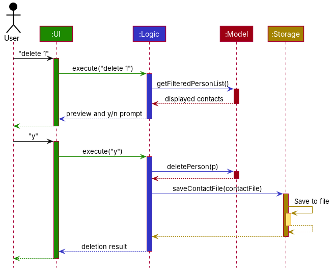

The first command only looks up the contact on display and returns a preview with a y/n prompt, so nothing is
changed or saved yet. The reply `y` makes `Logic` delete the contact from `Model` and save the contact file
through `Storage`. If saving fails, `Logic` restores the data that was in `Model` before the command.

Each of the four main components (also shown in the diagram above),

* defines its *API* in an `interface` with the same name as the Component.
* provides its functionality through a concrete `{Component Name}Manager` class that implements the corresponding API interface.

For example, the `Logic` component defines its API in `Logic.java` and implements it in `LogicManager.java`. Other components interact with a component through its interface rather than its concrete class, preventing them from coupling to that component's implementation, as illustrated in the following partial class diagram.

The sections below give more details of each component.

### UI component

The **API** of this component is specified in [`Ui.java`](https://github.com/AY2627S1-CS2103-F13-2/tp/tree/master/src/main/java/seedu/address/ui/Ui.java)

The UI consists of a `MainWindow` and its parts, such as `CommandBox`, `ResultDisplay`, `PersonListPanel`, `PersonDetailsPanel`, `FollowUpListPanel`, and `StatusBarFooter`. All of these, including `MainWindow`, inherit from the abstract `UiPart` class, which captures common behavior among classes that represent visible GUI parts.

The `UI` component uses the JavaFX UI framework. The layouts of these UI parts are defined in matching `.fxml` files in `src/main/resources/view`. For example, [`MainWindow.fxml`](https://github.com/AY2627S1-CS2103-F13-2/tp/tree/master/src/main/resources/view/MainWindow.fxml) specifies the layout of [`MainWindow`](https://github.com/AY2627S1-CS2103-F13-2/tp/tree/master/src/main/java/seedu/address/ui/MainWindow.java).

The `PersonListPanel` observes the filtered contact list exposed by the `Model`. When a find command changes the filtered list, the panel refreshes the visible contact cards.

Each contact is rendered by `PersonCard`. The card displays the contact's name, tags, company, role, phone, email, LinkedIn profile, introducer, events, and follow-up information. Optional fields are hidden when they are absent.

The contact card layout is defined in `PersonListCard.fxml`. Common visual styling is defined in `DarkTheme.css`, and `AstraTheme.css` is applied on top of it.

`MainWindow` composes the main UI parts, including `CommandBox`, `ResultDisplay`, `PersonListPanel`, `PersonDetailsPanel`, `FollowUpListPanel`, `StatusBarFooter`, `HelpWindow`, and `ConfirmationPanel`.

`PersonDetailsPanel` is the detail card beside the contact list. It shows every stored detail of the contact that a command such as `view` returned, in the saved field order. `FollowUpListPanel` takes the place of the contact list while a `followups` result is shown. It lists the follow-ups in the same numbered order as the command's feedback; selecting a row, by clicking or with the arrow keys, shows that contact and follow-up in `PersonDetailsPanel`.

`ConfirmationPanel` displays the active confirmation request and its preview. Users can confirm or cancel the request using the panel buttons, or enter `y`, `n`, or `cancel` in the command box. Button responses are passed back through `MainWindow` and use the same command execution path as typed responses.

The panel is shown only while a confirmation request is active. It is hidden after the request is completed, cancelled, or replaced. A revision number is used to ignore delayed button events from an older confirmation request.

The `UI` component,

* executes user commands using the `Logic` component.
* listens for changes to `Model` data so that the UI can be updated with the modified data.
* keeps a reference to the `Logic` component, because the `UI` relies on the `Logic` to execute commands.
* depends on some classes in the `Model` component because it displays `Person` objects from the model.

### Logic component

**API** : [`Logic.java`](https://github.com/AY2627S1-CS2103-F13-2/tp/tree/master/src/main/java/seedu/address/logic/Logic.java)

Here's a (partial) class diagram of the `Logic` component:

The sequence diagram below shows how Logic resolves `delete 1`, waits for `y`,
then mutates and saves. Parsing is omitted from this diagram.

How the `Logic` component works:

1. When `Logic` is called upon to execute a command, the command is passed to a `ContactFileParser` object, which in turn creates a parser that matches the command (e.g., `DeleteCommandParser`) and uses it to parse the command.
1. This results in a `Command` object (more precisely, an object of one of its subclasses e.g., `DeleteCommand`) which is executed by the `LogicManager`.
1. The command can communicate with the `Model` when it is executed (e.g. to delete a person). 
   Note that although this is shown as a single step in the diagram above for simplicity, the code can require several interactions between the command object and the `Model` to complete the operation.
1. The result of the command execution is encapsulated as a `CommandResult` object which is returned from `Logic`.
1. A result carrying a `PendingRequest` is retained by Logic until the user
   answers or cancels. Replies go to that request before normal command parsing.
   Completed data changes are saved transactionally; read-only results are not.

Here are the other classes in `Logic` (omitted from the class diagram above) that are used for parsing a user command:

How the parsing works:
* When called upon to parse a user command, the `ContactFileParser` class creates an `XYZCommandParser` (`XYZ` is a placeholder for the specific command name, e.g., `AddCommandParser`). The parser uses the other classes shown above to parse the user command and create an `XYZCommand` object (e.g., `AddCommand`). The `ContactFileParser` returns that object as a `Command` object.
* All `XYZCommandParser` classes, such as `AddCommandParser` and `DeleteCommandParser`, implement the `Parser` interface so they can be treated similarly where appropriate, for example during testing.

### Model component
**API** : [`Model.java`](https://github.com/AY2627S1-CS2103-F13-2/tp/tree/master/src/main/java/seedu/address/model/Model.java)

The diagram shows only the methods discussed in this guide. `ModelManager` implements every method of `Model`, so its methods are not repeated.

The `Model` component,

* stores the contact file data i.e., all `Person` objects, in a `UniquePersonList` inside a `ContactFile`. `ModelManager` builds its own copies of the `ContactFile` and `UserPrefs` it is given, so it owns them (composition).
* a `Person` always has a `Name`, and may additionally have a `Company`, `Role`, `Phone`, `Email`, `Linkedin` and an introducer (the `Name` of the person who introduced them). Every field other than the name is optional, because a contact met at a networking event is often captured with only the details that were exchanged. Optional fields are exposed as `Optional<...>` so callers must handle an absent value. These single-value classes, and `Tag`, are shown as attributes of `Person` rather than as separate classes.
* a `Person` also holds any number of tags, `Event`s, `FollowUp`s and `Interaction`s, a starred flag, and the last follow-up ID it allocated.
* `Person` is immutable. `withStarred`, `withEvent`, `appendFollowUp`, `removeFollowUp` and `withInteraction` each return a new `Person`, which `Model#setPerson` puts in place of the old one. The new `Person` shares its unchanged `Event`, `FollowUp` and `Interaction` objects with the old one, so these are drawn as associations rather than compositions.
* `Person#isSamePerson` compares equal names and emails that are either both absent or equal ignoring case.
  Current add/edit validation separately rejects shared normalized phone numbers and case-insensitive emails.
  Follow-ups, retired action IDs, events, interactions, and starred status do not change contact identity.
* a `FollowUp` has an ID, a description, an optional due date and a `Status` (`PENDING` or `COMPLETED`). `FollowUp#isOverdue` is true for a pending follow-up whose due date has passed. `Model#getFollowUps` creates a `FollowUpEntry` for each follow-up, pairing it with its contact; `Model#getPendingFollowUps` retains only pending actions from that snapshot.
* stores the `Person` objects selected by the current filter, such as search results, in a separate _filtered_ list (`filteredPersons`). It exposes this list as an unmodifiable `ObservableList<Person>` that the UI can observe and bind to, so the UI updates when the list changes.
* stores a `UserPrefs` object that represents the user’s preferences (GUI settings, command aliases and the global contact field order). This is exposed to the outside as a `ReadOnlyUserPrefs` object. The field order is a `FieldOrder`, which lists each of the ten `Field` values exactly once.
* provides `ModelSnapshot`, which copies the contact file and preferences and keeps the current filter. `Logic` takes one before a command so that it can `restore` the model if the command fails or is cancelled (see [Pending requests and transactional commands](#pending-requests-and-transactional-commands)).
* how a follow-up is added through an immutable `Person`, and why follow-up IDs are never reused, is shown in [Follow-up actions (UC16)](#follow-up-actions-uc16).
* does not depend on any of the other three components (as the `Model` represents data entities of the domain, they should make sense on their own without depending on other components)

### Storage component

**API** : [`Storage.java`](https://github.com/AY2627S1-CS2103-F13-2/tp/tree/master/src/main/java/seedu/address/storage/Storage.java)

The `Storage` component,
* can save both contact file data and user preference data in JSON format, and read them back into corresponding objects.
* is implemented by `StorageManager`, which delegates the actual JSON file access to `JsonContactFileStorage` and `JsonUserPrefsStorage` (one class per data file).
  Both use `AtomicFileWriter` for candidate writing, verification, atomic replacement and cleanup.
  Callers retain data-specific validation. `ContactStartupLoader` also retains recovery archiving and
  the original-file change check.
* depends on some classes in the `Model` component (because the `Storage` component's job is to save/retrieve objects that belong to the `Model`)

`JsonAdaptedPerson` uses one optional-scalar helper for absent-value handling, validation and construction.
Required-name validation and collection-specific rules remain in separate conversion helpers.
`ContactTextField` holds the shared text-field constraints used by conversion and startup recovery.
Recovery still checks raw JSON types and collects field-specific errors before conversion; it owns
the decision to skip a record and retains the original record positions in its report.

### Common classes

Classes used by multiple components are in the `seedu.address.commons` package.

--------------------------------------------------------------------------------------------------------------------

## **Implementation**

This section describes some noteworthy details on how certain features are implemented.

### Shared contact matching

`NameContainsKeywordsPredicate` supplies the existing contiguous, partial,
case-insensitive name matching used by find, edit, delete, and view.
`PersonNameResolver#resolve` keeps edit and view's numbered-retry behavior.
`PersonNameResolver#findMatches` performs the same full-file lookup without
changing the displayed list; delete uses it before creating a pending request.
Ambiguous delete names display candidates and require a numeric reply followed
by a separate y/n confirmation. A name never implicitly selects the first match.

### Finding contacts by different criteria

`FindCommandParser` determines the search mode from the user's input and
creates a `FindCommand` containing the corresponding predicate.

The following predicates support the implemented search modes:

* `NameContainsKeywordsPredicate` performs case-insensitive contiguous and
  partial name matching.
* `FuzzyNamePredicate` normalises the query and compares it with each individual
  word in a contact's name using Levenshtein distance. A contact matches when at
  least one name word is within a distance of two from the query.
* `ContactFieldPredicate` searches fields such as phone number, email, company,
  and role.
* `EventContainsKeywordsPredicate` searches the names of events associated with
  each contact.
* `NoteContainsKeywordsPredicate` performs case-insensitive partial matching
  against the notes in a contact's interaction history. `FindNotesCommand`
  executes the `/notes` search and displays contacts with matching notes.

When both `/company` and `/role` are provided, the parser combines the two
predicates. A contact must satisfy both criteria to be included in the results.

The resulting predicate is passed to the model to update its filtered contact
list. The UI observes this list and refreshes the displayed `PersonCard`
objects automatically. Searching does not modify stored contact data.

Invalid search values are rejected by the parser. If no contacts match the
search, Astra reports the result without modifying the stored contact file.

The following class diagram shows the relationship between the find command
and its search predicates:

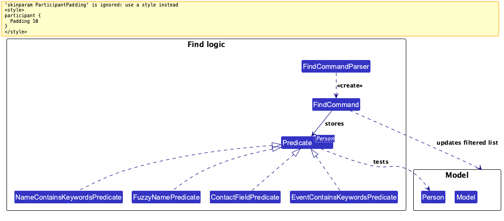

The following sequence diagram shows how a find command is parsed, executed,
and reflected in the displayed contact list:

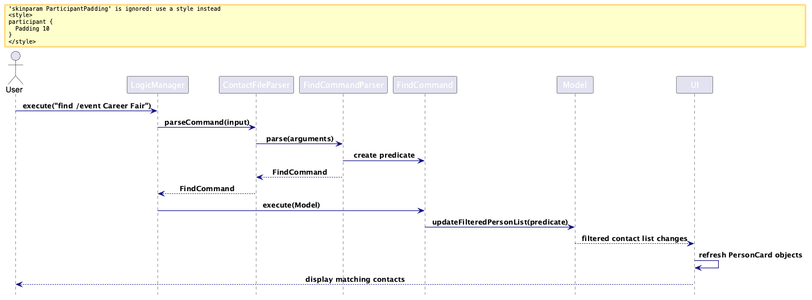

### Viewing contacts by name or displayed index

`ViewCommandParser` normalizes whitespace and uses `ParserUtil#isIndexInput` to classify the selector.
A numeric first token must form one valid positive index; otherwise the complete input must be a valid
name. Prefix syntax is rejected. `ViewCommand` resolves a name with `PersonNameResolver` and sends a
unique contact to the same `Messages#format` path as index selection, using the saved field order.
Both paths retain the contact in the result so changes to field order immediately refresh viewed details.
Absent optional fields are omitted.
Several matches return the resolver's numbered candidates and a command-specific retry instruction.
There is no pending request or y/n prompt: the next `view INDEX` simply selects from the current list.

Index selection keeps the current filter, while name resolution searches all contacts and replaces the
filter with the matching names. `LogicManager` restores the pre-command snapshot on lookup/parse failure,
including the original dynamic predicate and existing observable-list binding. Successful unique and
ambiguous lookups change no contact data, so the transactional save boundary performs zero writes.
`list` restores the full list. No matching, formatting, or persistence rule is duplicated in the view command.

### Normalized contact keys

Phone matching uses `Phone#matches`, which removes spaces, hyphens, and
parentheses but preserves a leading plus. Equality and hashing use that same
canonical value. Email matching uses `Email#matches` and ignores letter case.
`ContactFieldPredicate`, duplicate checks, delete, and startup recovery share
these comparisons. Missing phone/email values are not shared keys.

### Pending requests and transactional commands

`CommandResult` can carry a `PendingRequest`. `LogicManager` retains it together
with a `ModelSnapshot` captured before the initial command. `ConfirmationRequest`
executes its resolved command only for y. `PersonSelectionRequest` turns a
numbered candidate selection into the next request; it retains contact
references rather than resolving a displayed index again later.

Logic handles n/cancel centrally, restores the pre-request filter, and discards
the request. Invalid replies repeat the current prompt; unrelated commands are
not executed while a confirmation or destructive selection is pending. Read-only
follow-up review selections may hand off to normal commands. A completed or failed confirmed request
clears pending state, so a stale y cannot replay the mutation. UC16 reuses the
shared confirmation API with an "Add another?" question for duplicate pending
actions.

`ModelSnapshot` is the Model's restore point for one request. It copies the
contact file and the user preferences, and keeps the active filter. Logic uses
it in three ways:

* **To decide whether to save.** After a command, `hasDataChanged` and
  `hasPreferencesChanged` compare the model with the snapshot, so only changed
  data is written. Queries, ambiguity results, prompts, selections,
  cancellations and no-ops perform no contact-file write.
* **To roll back a failure.** If a command or a save throws, `restore` puts the
  copied data and the original filter back, so the model never shows a change
  that was not saved.
* **To cancel a pending request.** The snapshot is kept with the request until
  the user replies. `n` or `cancel` restores it, which also brings back the
  list the user saw before, such as the full list after a name lookup narrowed
  it to the candidates.

`restore` copies the saved contacts back into the existing lists instead of
replacing them, so the observable lists bound to the UI stay connected.

The sequence diagram below shows `delete 1` followed by a reply. The first
input only takes the snapshot and creates the request; nothing is deleted yet.
The `alt` frame shows the two replies:

* `y` runs the resolved command, finds that the data changed, and saves. The
  `opt` frame shows the rollback when that save fails.
* `n` or `cancel` restores the snapshot straight away, without saving.

Either way, Logic then discards both the request and the snapshot. The details
of the two `ref` frames are shown in the two diagrams after it.

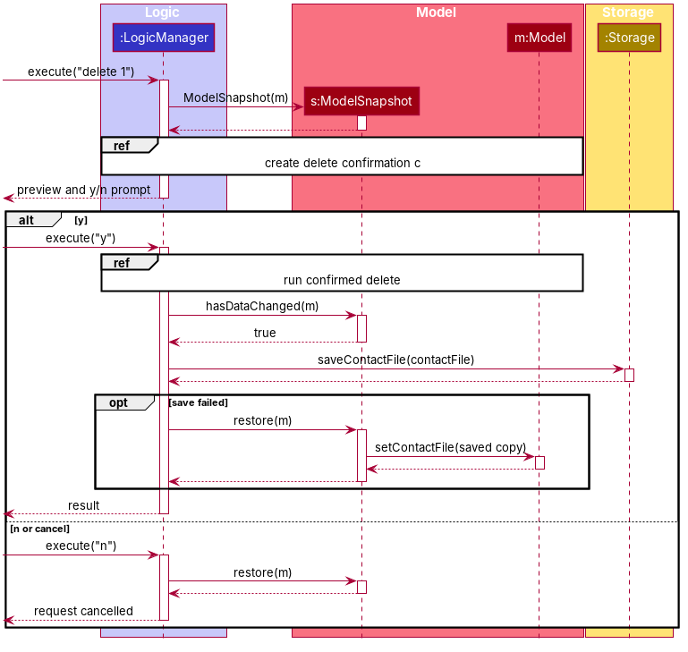

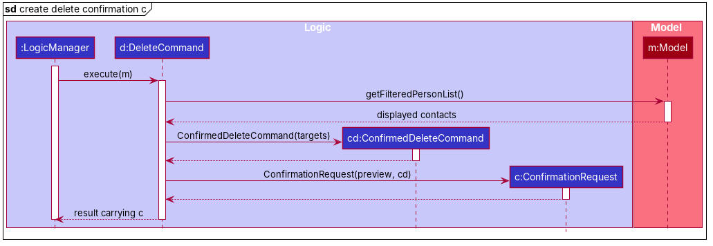

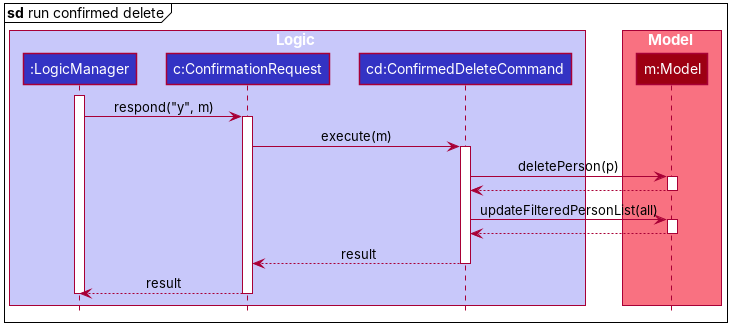

`JsonContactFileStorage` serializes to a sibling temporary file, reloads and
compares the candidate, then uses atomic replacement. Failures before
replacement preserve the previous active file. Temporary-file cleanup never
turns an already successful replacement into a reported transaction failure.
No unsafe in-place fallback is used when atomic replacement is unavailable.

#### Design considerations

**Aspect: How a failed or cancelled request is undone**

* **Alternative 1 (current choice):** Logic takes a `ModelSnapshot` before each
  request and calls `restore` if the request fails or is cancelled.
  * Pros: Rollback is handled in one place, so no command needs its own undo
    logic. The snapshot copies only the list of contacts, not the contacts
    themselves, because `Person` is immutable. The same snapshot also tells
    Logic whether anything needs saving.
  * Cons: Every request copies the contact list and preferences, even one
    that changes nothing. The snapshot covers only the current request, so it
    is not a multi-step undo history.
* **Alternative 2:** Each command reverses its own changes when something
  fails.
  * Pros: Nothing is copied unless a command needs it.
  * Cons: Every command needs its own correct reverse logic, including for
    the filter and preferences. A missed case leaves the model showing a
    change that was never saved.

### Tag filtering (UC20)

`FilterCommandParser` uses the shared prefix tokenizer with repeated `t/`
values and one optional `mode/`. It validates every tag through
`ParserUtil#parseTags` before executing the command; a missing tag, malformed
value, unsupported mode, or repeated mode cannot change the displayed list.
Whitespace separators are normalized locally because neither valid tag names
nor mode values contain whitespace. Mode values use locale-independent case
folding; prefixes and `Tag` equality remain case-sensitive.

`TagFilterPredicate` copies the requested tags into an immutable non-empty set.
AND uses `containsAll`; OR requires any requested tag to occur in a contact's
tag set. Repeated requested tags are collapsed before matching. The command
replaces the model's active predicate, so it searches the full stored list
rather than intersecting the previous results. JavaFX's existing filtered list
retains stored order and its observable binding; no contact is copied, sorted,
or duplicated for the query.

The result reports a count and mode, or a clear no-match message with an empty
list. `view INDEX` continues to resolve the displayed list, and `list` resets
the predicate. Filtering does not change contact contents, so Logic's existing
transaction change detection performs no contact-file save. Parser failures
restore the previous predicate through the same snapshot boundary.

AND is the default, and one mode applies to the entire command, because mixed
AND/OR expressions would need a query syntax that slows down typing. OR is
offered as well so that a user can gather contacts from several categories at
once. No tag/schema or contact identity change is needed. The following
diagram's editable source is `docs/diagrams/TagFilterActivityDiagram.dot`.

### Starred status and follow-up integration (UC21)

`Person.withStarred(boolean)` copies every contact field and the complete ordered
follow-up history. Appending a follow-up and editing contact details retain the
starred flag. Strong equality and hashing include both metadata fields, so Logic
saves actual changes and rolls both back together on storage failure. JSON stores
both fields; older files default to unstarred contacts with empty action history.

### Follow-up actions (UC16)

`Person` owns an immutable ordered `List<FollowUp>`. Each action has a positive
ID unique within that contact, a stripped non-blank description, and a
`PENDING` or `COMPLETED` status. IDs are allocated as one greater than the
greatest allocated ID (`Person.lastFollowUpId`), including deleted and completed history,
rather than the list size or last surviving element. Existing IDs and order never change;
ID exhaustion is rejected without mutation. Every copy preserves the counter, which participates
in strong equality/hash. `appendFollowUp` rejects reused IDs; replacement preserves the action ID.

The sequence diagram below shows how a follow-up is added inside the Model.
It starts at `AddFollowUpCommand`, the command `FollowUpCommand` creates for
the resolved contact. That command runs straight away, or after a `y` reply
when the same pending follow-up already exists.

1. The new follow-up gets ID `n + 1`, where `n` is the contact's
   `lastFollowUpId`.
1. `Person` is immutable, so `appendFollowUp` returns a new `Person` with the
   follow-up added and the counter raised to `n + 1`. The old `Person` is not
   changed.
1. `Model#setPerson` passes the new `Person` down to the `UniquePersonList`,
   which puts it in the old one's position. The filtered list and the UI
   update without being rebuilt.

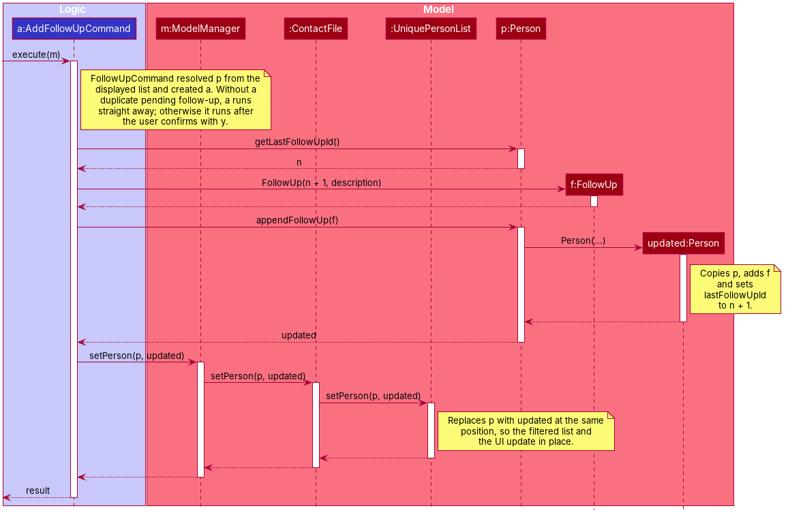

The object diagram below shows why IDs come from `lastFollowUpId` rather than
the list size. Each frame is a new `Person`, since every change creates one.
After follow-up 2 is deleted, the counter stays at 2, so the next follow-up
gets ID 3. Using the list size would have given it ID 2 again, and a command
or note that referred to the deleted follow-up 2 would then point at the new
one.

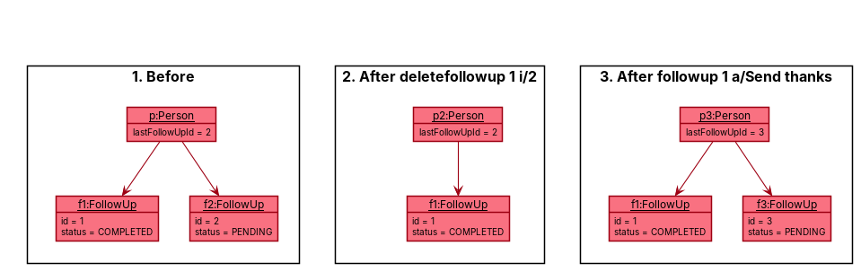

Status changes are described in
[Completing and reopening follow-ups](#completing-and-reopening-follow-ups-uc17).

`FollowUpCommandParser` requires a positive displayed index and exactly one
`a/` description. Extra prefix-shaped tokens (such as `confirm/yes`) are
rejected instead of being silently stored as description text. Exact trimmed,
case-sensitive description equality defines duplicates, and only pending
actions trigger confirmation. The command retains the resolved contact and
description in the shared request. A later displayed index cannot redirect a
confirmed action; a changed or missing target invalidates the request.

Strong `Person` equality/hash include allocated IDs and ordered follow-ups so Logic detects and
saves an action change. Contact identity and phone/email duplicate checks do
not include actions. `EditCommand` carries existing history into the replacement
contact, and `PersonBuilder` preserves history when copying a contact in tests.
Model replacement updates bound cards immediately; cards and full details show
each action's stable ID and status, with no blank action row for empty history.

`JsonAdaptedPerson` defaults a missing/null `followUps` property to an empty
list for old files. `JsonAdaptedFollowUp` validates raw JSON field types,
positive integer IDs, non-blank descriptions, and supported status values;
duplicate IDs and null actions invalidate the entire contact. Startup recovery
uses the same conversion and reports/skips the affected record, preserving its
original bytes in the existing recovery archive. Valid histories retain their
order, status, and IDs through normal saves and recovery. `lastFollowUpId` is stored as an integer
at least as large as every remaining ID. Missing/null legacy values infer the maximum remaining ID
(or zero for no actions); invalid types, negative values, overflow, and counters below existing IDs
invalidate the contact. Historical deleted IDs cannot be reconstructed from a legacy file that never
stored them. Failed immediate or
confirmed saves restore the original action history, model, and predicate.

The following activity diagram shows the command and transaction boundaries.
Its editable source is `docs/diagrams/FollowUpActivityDiagram.dot`.

#### Design considerations

**Aspect: How a contact is updated**

* **Alternative 1 (current choice):** `Person` is immutable. Every change
  creates a new `Person`, and `Model#setPerson` puts it in place of the old
  one.
  * Pros: Old `Person` objects never change, so `ModelSnapshot` can keep them
    as they are and rollback needs no deep copy. Replacing the whole object
    is one list change, which the UI already observes.
  * Cons: Each change copies every field. The full constructor takes many
    arguments, and every new field has to be carried through it.
* **Alternative 2:** Change the fields of the existing `Person` in place.
  * Pros: Less copying, and simpler code for each update.
  * Cons: A snapshot would need a deep copy of every contact. A command that
    fails halfway could leave a half-changed contact, and the UI would need
    an observable property for every field to notice the change.

**Aspect: How follow-up IDs are allocated**

* **Alternative 1 (current choice):** Each contact stores `lastFollowUpId`,
  and a new follow-up gets that counter plus one. The counter never goes
  down.
  * Pros: A deleted ID is never handed out again, so an ID the user types,
    such as in `deletefollowup 1 i/2`, always means the same follow-up. IDs
    stay short and easy to type, and existing IDs never change.
  * Cons: The counter must be saved and validated with each contact. Deleting
    leaves gaps in the numbering. Older data files without the counter cannot
    recover IDs deleted before it was added.
* **Alternative 2:** Use the follow-up's position, or the list size plus one.
  * Pros: Nothing extra to store.
  * Cons: Deleting a follow-up renumbers the later ones or reuses an ID, so a
    command that names an older ID could change the wrong follow-up.
* **Alternative 3:** Use random unique IDs, such as UUIDs.
  * Pros: IDs never clash, even across contacts.
  * Cons: Long IDs are slow and error-prone to type in a command-line app.

### Completing and reopening follow-ups (UC17)

`completefollowup` and `reopenfollowup` share `ChangeFollowUpStatusCommand`, which
holds the displayed contact index, the follow-up ID and the target `FollowUp.Status`.
`ContactFileParser` registers one `ChangeFollowUpStatusCommandParser` per command
word, each fixed to its target status, so the parser only accepts
`CONTACT_INDEX i/FOLLOW_UP_ID` and reports the usage of the word that was typed.

On execution the command resolves the contact from the filtered list and the
action by its stable ID, then builds a replacement `FollowUp` that copies the ID,
description and due date with the new status. `Person#replaceFollowUp` keeps the
action at the same position, so history order and later ID allocation are
unaffected. The command rejects, without mutation, a follow-up that already has
the target status, and a reopen that would leave two pending actions with the
same description. That matches the duplicate rule used by `editfollowup`.
Because the overdue flag and every `followups` view (`FollowUpFilter`) read the
status, a completed action moves from the pending and date-based views to
`followups completed` and loses `[OVERDUE]` with no extra bookkeeping, and a
reopened one moves back. Logic saves the change through the usual transactional save, and
a failed save restores the previous status.

### Deleting follow-ups and the confirmation panel

`DeleteFollowUpCommandParser` accepts `deletefollowup CONTACT_INDEX i/FOLLOW_UP_ID`.
The command resolves the displayed contact and stable action ID before producing a
`ConfirmationRequest`. Its retained contact must still match at confirmation. `Person.removeFollowUp`
removes exactly one action without renumbering survivors or changing `lastFollowUpId`.
Logic saves once on success and restores the original model, filter, and counter on failure.
Deletion is permanent; the existing contact undo feature does not undo action deletion.

`ConfirmationPanel` renders any `ConfirmationRequest`, including edit, delete, clear,
follow-up deletion, duplicate follow-ups, and other existing y/n confirmations. Selection requests
are not shown as confirmations. MainWindow feeds both typed and button replies through Logic;
the panel never mutates the model. A revision check discards events from a hidden/replaced panel.
Invalid replies retain the prompt; completion, cancellation, or failure hides/unmanages it.
The preview wraps and scrolls; Tab navigation and the command box remain available.

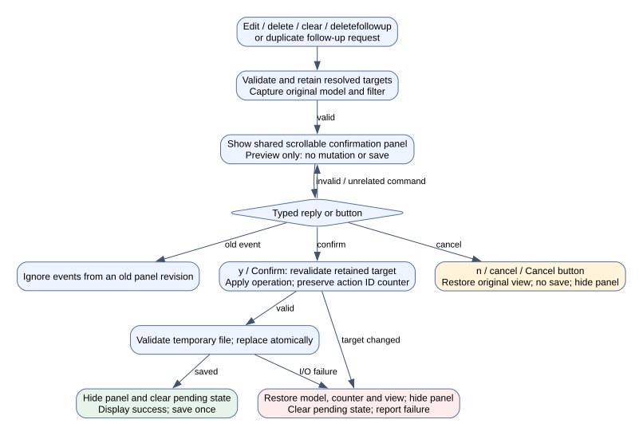

### Display-field order (UC26)

`FieldOrder` is an immutable permutation of all ten supported fields. Its
constructor validates field count, case-insensitive names, and uniqueness;
partial orders cannot hide fields. The default matches the original card order
with follow-ups last. `UserPrefs` stores this global value and includes it in
copy/equality/hash. JSON uses a canonical array of lower-case field names in
`fieldOrder`; old preference files without that property retain the default.
Malformed or null orders are rejected by preference loading, using the existing
startup fallback to default preferences.

`OrderCommandParser` accepts a no-argument query or one complete permutation.
`OrderCommand` changes only preferences. A query or unchanged order makes no
mutation and performs no save. `ModelSnapshot` includes preferences as well
as contact data and the active predicate. Logic detects preference changes
separately from contact changes, saves the corresponding file, and restores the
captured model/predicate on failure. Each command changes at most one
persistence domain; ordering never writes the contact file.

`JsonUserPrefsStorage` copies the requested preferences, writes a sibling
temporary file, reloads and compares it, then atomically replaces the active
file. Failed writes, invalid/different/missing candidates, or replacement
failures preserve the old file. Temporary cleanup failure after successful
replacement is logged without reporting a false transaction failure. Startup
and shutdown preference saves also use this path.

The model exposes a read-only observable field order through Logic.
`PersonListPanel` refreshes existing cells when it changes; `PersonCard` arranges
its field nodes in that order. The displayed index stays with the name row.
Absent optional values, empty tags, and empty follow-up lists are invisible and
unmanaged, leaving no field rows behind. Contacts, selection indices, stored
order, active predicates, and observable-list bindings are retained.

`Messages#format(Person, FieldOrder)` formats full details in the same order.
View/add/delete detail output passes the active preference. A view result also
retains the contact as presentation metadata in `CommandResult`, so MainWindow
can refresh the last viewed details immediately without parsing feedback or
re-running view. An order change shows its confirmation and the refreshed
details; an error retains details in the restored order alongside the error.
Other successful commands replace the detail context normally. Preference
rollback notifies observers, returning visible cards/details to the saved order.

`order` reorders the fields within each contact, not the contacts themselves;
sorting contacts is a separate, lower-priority user story. The editable diagram
source is `docs/diagrams/FieldOrderActivityDiagram.dot`.

### Interaction history (UC10)

Each `Person` holds an immutable list of `Interaction`s, kept in date order, oldest first. An
`Interaction` is a `LocalDate` and a non-blank note; two interactions are the same if they have the same date
and the same note, ignoring letter case. The class diagram below shows where interactions sit across the
components.

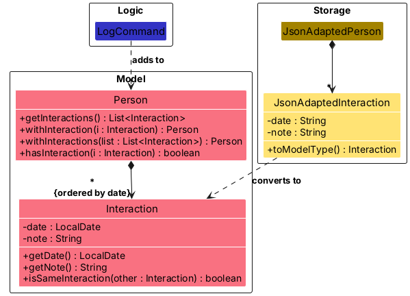

`Person` has one constructor that takes every field. `withInteraction`, `withInteractions`, `appendFollowUp`,
`withStarred` and `withEvent` all go through it, as do `edit`, `drop` and `introduce`, so changing one part of a
contact never drops another, such as logging an interaction on a contact with follow-ups.

The sequence diagram below shows how `log 1 nt/Coffee chat` is handled.

1. `ContactFileParser` passes the arguments to `LogCommandParser`, which fills in today's date when `d/` is left
   out and rejects a future date or a blank note before any `LogCommand` is created.
2. `LogCommand` finds the contact through `PersonNameResolver#resolveTarget`, by displayed index or by name. A
   name that matches several contacts lists them and changes nothing.
3. If the contact already has the same interaction, the command fails and the contact file is left unchanged.
   Otherwise `Person#withInteraction` returns a new `Person`, and `Model#setPerson` replaces the old one.
4. The displayed list keeps its filter, so an index still points to the same contact on the next command.
5. `LogicManager` saves the contact file because the contact data changed.

`Messages#format` shows the history as a numbered list, and it is one of the fields `order` can move, so it
appears wherever full details are shown. `JsonAdaptedInteraction` stores the date as `YYYY-MM-DD`. A contact
file written before this feature has no `interactions` field, which loads as an empty history. Loading applies
the same rules as `log`: a future date, a blank note or a repeated interaction makes that contact invalid, and it
goes through the usual recovery path.

A name target goes through `PersonNameResolver#resolveTarget`, which filters the displayed list to the
contacts matching the name. `log`, `unlog` and `editlog` leave that filter in place, so after a name target the list shows
those matches; after an index target the list is unchanged.

`unlog` (`UnlogCommand`) removes one entry, addressed by its number in the date-ordered history. Because a
removal cannot be undone and later entries are renumbered, the command returns a `ConfirmationRequest` that
shows the entry, and only the confirmed inner command changes the contact. That inner command first checks that
the contact is still stored unchanged, so a reply cannot remove an entry from a history that changed in between.

`find /notes KEYWORDS` is parsed by `FindCommandParser` into a `FindNotesCommand` with a
`NoteContainsKeywordsPredicate`. A contact matches when any of its notes contains any keyword as a substring,
ignoring letter case. The command filters the displayed list like `find`, and its result groups the matching
notes under each contact, shortening notes longer than 60 characters to an excerpt around the first match. When
nothing matches, the displayed list is left as it was.

`editlog` (`EditLogCommand`) corrects one entry in place. `EditLogCommandParser` accepts the same target
forms as `log` and `unlog`, a required `i/ENTRY`, and at least one of `d/` and `nt/`; it reuses
`LogCommandParser#parsePastDate`, so an edited date follows the same rules as a logged one. The command resolves
the contact through `PersonNameResolver`, builds a new `Interaction` from the given parts and the current
values of the rest, and replaces the entry through `Person#withInteractions`, which sorts the history again.
It rejects an edit that changes nothing and an edit that would duplicate another entry, so the stored
history never breaks the rules that loading checks. A new date can move the entry, so the result reports
its new number together with the renumbered history. No confirmation is asked, because the change can be
reversed by another `editlog`, unlike `unlog`.

Design considerations:

* **Where the history lives:** as a list inside `Person` (chosen) or as a separate store keyed by contact.
  Keeping it in `Person` means `edit`, deletion, undo snapshots and saving all handle it with no extra code. The
  cost is that every method that copies a `Person` must pass the history on, which the single full constructor
  makes hard to forget.
* **Order:** sorted by date when stored (chosen), or kept in the order logged. Sorting means an interaction
  logged late appears where it belongs, and the entry numbers that `view` shows are stable.
* **Correcting an entry:** an `editlog` command (chosen), or only `unlog` followed by `log`. Editing keeps
  the other part of the entry, needs one command instead of two and no confirmation, and cannot lose the
  entry if the second command fails.

### Command shortcuts

`alias` (`AliasCommand`, parsed by `AliasCommandParser`) defines, replaces, removes and lists shortcuts. Shortcuts
are a `Map<String, String>` from a lower-case shortcut to the command text it stands for, held in `UserPrefs` and
saved to `preferences.json`. `LogicManager` saves the preferences straight after a command changes them, and a
failed save restores the previous shortcuts.

`ContactFileParser` keeps the only list of built-in command words. `ContactFileParser#expandShortcut` replaces a
leading shortcut with its command text and keeps the rest of the input, and is skipped when the first word is a
built-in command word, so a shortcut can never hide a command. `AliasCommandParser` uses the same list to reject a
shortcut named after a command, and a target that does not start with a built-in command word other than `alias`,
which also rules out a shortcut standing for another shortcut. When Logic
starts, `AliasCommandParser#validAliases` drops any entry in a hand-edited preferences file that breaks these rules.

`LogicManager` expands the input before parsing. When a shortcut was used, it prefixes the result, and any
error, with `Ran: <expanded command>`, so the user sees exactly what was run.

### Undo and session history

Astra does not use the AB3 `VersionedContactFile` redo stack. The implemented undo feature is session-scoped and command-driven: `UndoManager` keeps a list of successful data-changing commands and remembers the latest undoable `edit` or `delete` entry. This is intentionally limited to the current app session; when Astra closes, the undo history is cleared.

`UndoCommand` calls `UndoManager#executeUndo`, which returns a result carrying a `ConfirmationRequest` that previews the most recent edit or deletion. The preview does not mutate the model or save the contact file. If the user replies `y`, the confirmed request restores the previous person version by replacing the changed contact or re-inserting the deleted contact at its original index. It also validates the resulting list against contact uniqueness rules before accepting the undo, so a restored person cannot introduce duplicate names, emails or phone numbers. Only edit and deletion actions are tracked for undo; other commands either do not modify contact data or are explicitly not undoable.

`history` shows, newest first, every successful `add`, `edit`, `delete`, `drop`, `clear` and `introduce` in the session, and marks each undone item as `(undone)`. This gives the user a concise record of restore actions without exposing the AB3 redo model or stale state diagrams.

The sequence diagram below shows a batch-style delete undo flow: the user deletes a contact, reviews the undo preview, then confirms restoration. The same pattern is used for edit undo, with the restore step replacing the changed person rather than re-adding it.

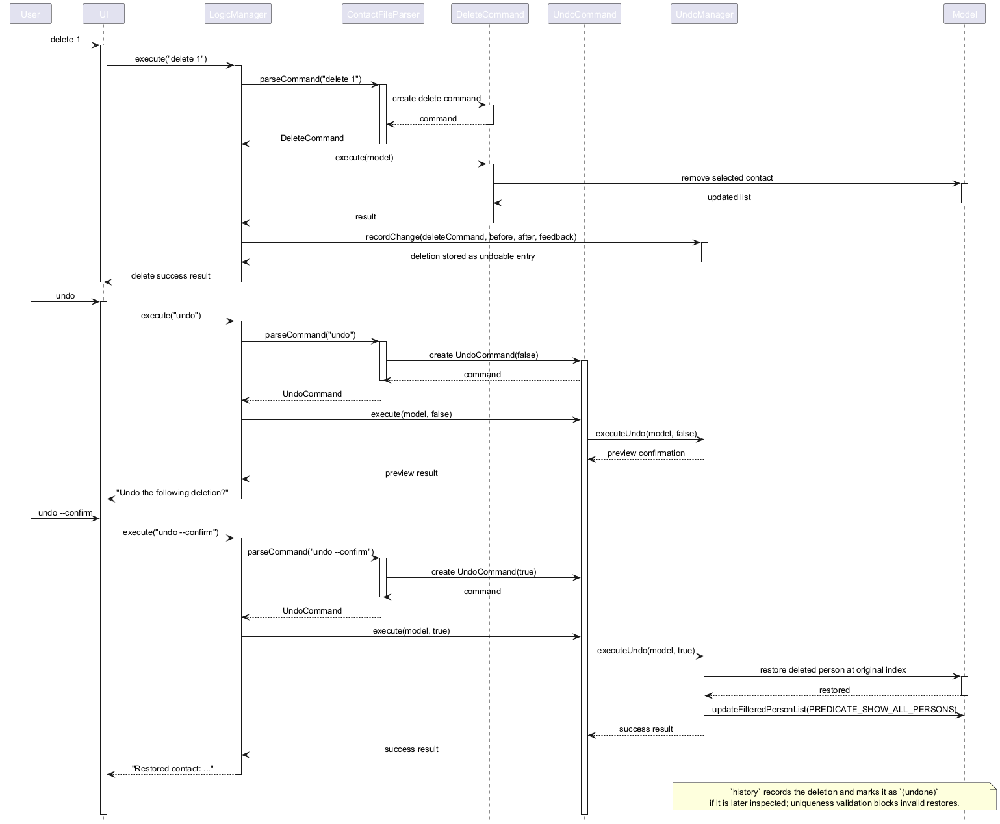

#### Design considerations

**Aspect: How undo is implemented**

* **Alternative 1 (current choice):** Keep a session list of successful edit/delete snapshots in `UndoManager`.
  * Pros: Undo is centralized, easy to reason about, and fits the app's confirmation workflow. The preview and confirm steps are handled in one place, and the data model need not implement its own rollback logic.
  * Cons: Undo is limited to the current session and only tracks the latest undoable change, which is deliberate for the app's current user flow.

* **Alternative 2:** Store a full undo/redo stack in the model.
  * Pros: Keeps a longer history of state changes.
  * Cons: It is more complex than the app needs, and it does not match the implemented confirmation-first undo workflow or the existing session history design.

--------------------------------------------------------------------------------------------------------------------

## **Documentation, logging, testing, dev-ops**

* [Documentation guide](Documentation.md)
* [Testing guide](Testing.md)
* [Logging guide](Logging.md)
* [DevOps guide](DevOps.md)

--------------------------------------------------------------------------------------------------------------------

## **Appendix: Requirements**

### Product scope

**Target user profile**:

* attends networking events, career fairs or conferences regularly
* meets many new people in a short span and struggles to recall who was who afterwards
* wants to capture contact details (company, role phone number, email, LinkedIn) and context in seconds, mid-conversation or right after
* prefers desktop apps over other types of applications
* can type fast and prefers typing to mouse interactions
* is reasonably comfortable using CLI apps

**Value proposition**: Networking events generate more contacts than anyone can remember and more context than a phone contacts app can hold. Astra lets a fast typist capture each new person (role, company, LinkedIn, who introduced them, and what was discussed) in the seconds between conversations, and search any of it back up instantly, so no one you met becomes "that person from the fair".

### User stories

Priorities: High (must have) - `* * *`, Medium (nice to have) - `* *`, Low (unlikely to have) - `*`

| Priority | As a …​                                    | I want to …​                     | So that I can…​                                                        |
| -------- | ------------------------------------------ | ------------------------------ | ---------------------------------------------------------------------- |
| `* * *`  | user                                       | add a new contact with their name, company, role and contact details               | remember and reach out to the people I meet                            |
| `* * *` | user                                        | view all the information stored about a contact in one place   | refresh my memory before meeting them again                      |
| `* * *`  | user                                       | record a contact's LinkedIn profile | look up their professional background later                       |
| `* * *`  | user                                       | delete a person                | remove entries that I no longer need                                   |
| `* * *`  | user                                       | find a person by name          | locate details of persons without having to go through the entire list |
| `* * *`  | user                                     | edit a contact's details                                            | fix mistakes or add details I learn later                         |
| `* * *`  | frequent user                              | delete contacts I no longer need | reduce clutter                                                         |
| `* * *`  | user                                       | clear all contacts | start over when I no longer need the list                              |
| `* *`    | careless user                              | be asked to confirm before contacts are deleted or cleared | avoid wiping out contacts by a mistyped command                  |
| `* * *`  | user                                       | exit the app with all saved changes kept | close it without worrying about losing data
| `* * *`  | user                                       | find a contact by name, phone number or email                       | retrieve their details quickly                                    |
| `* * *`  | user                                       | find a contact using only part of their name                        | look someone up when I only remember their first or last name     |
| `* * *`  | user                                       | list all contacts                                                   | browse my contact list                                            |
| `* * *`  | user                                     | retrieve my contacts after closing and reopening the app            | keep what I have recorded                                         |
| `* * *`  | new user                                 | view help for the available commands                                | learn the commands without memorising them                        |
|`* * `| user                                          | record where I met the contact and what we discussed       | have context for the next conversation                         |
|`* * `| user                                          | record who introduced me to a contact                     | remember how I am connected to them |
| `* *`    | user who struggles with names              | find someone without typing the exact spelling of their name        | look them up even when I misremember their name                   |
| `* * *`  | user                                       | find a contact by company or role                                   | retrieve contacts from a particular organisation or profession     |
| `* * *`  | user                                       | find contacts by an event                                          | recall who I met at a particular networking event                 |
| `* *`    | user                                       | filter contacts by categories or custom tags                        | narrow down a large list quickly                                  |
| `* *`    | frequent user                              | star important contacts                                             | revisit them quickly                                              |
| `* *`    | user                                       | hide private contact details   | minimize chance of someone else seeing them by accident                |
| `* *`    | user                                       | record follow-up actions for a contact | remember what I need to do after meeting them                          |
| `* *`    | user                                       | mark a follow-up action as completed | tell pending tasks apart from finished ones                            |
| `* *`    | user                                       | see when I last interacted with someone | know how long it has been since we last met                            |
| `* *`    | careless user                            | undo an accidental deletion or edit                                 | avoid losing important information                                |
| `* *`    | potential user exploring the app         | see the app populated with sample data                              | get a feel for how the app looks in use                           |
| `*`      | user with many persons in the contact file | sort persons by name           | locate a person easily                                                 |
| `*`      | user                                     | see which contact entries are incomplete                            | remember to fill in missing details later                         |
| `*`      | frequent user                            | reorder the information shown for a contact                         | see the details I care about first                                |
| `*`      | expert user                              | define shortcuts for commands                                       | add contacts faster than typing commands in full                  |
| `*`      | frequent user                            | reuse templates of common fields when adding contacts               | enter repetitive data faster                                      |
| `*`      | first-time user                          | follow a tutorial of the main features                              | start using the app confidently                                   |
| `*`      | user                                     | protect my contact data with a password                             | stop other people using my device from viewing it                 |
| `* *`    | user                                     | remove one detail of a contact without retyping the others          | discard outdated details quickly                                  |
| `* *`    | user                                     | log what I discussed with a contact and when                        | prepare for our next conversation                                 |
| `* *`    | user                                     | correct or remove an interaction I logged by mistake                | keep a contact's history accurate                                 |
| `* *`    | user                                     | find contacts by what we discussed                                  | recall who mentioned a topic                                      |
| `* *`    | user                                     | review overdue, upcoming and undated follow-ups across all contacts | decide what to do next                                            |
| `* *`    | user                                     | edit or delete a follow-up action                                   | keep my to-do list accurate                                       |
| `*`      | user                                     | see the changes I made to my contacts in this session               | check what I changed before I undo anything                       |

### Use cases

The following use case diagram summarizes the main interactions supported by Astra.

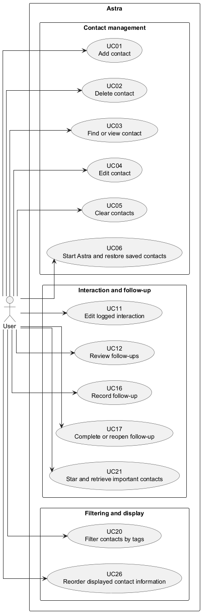

(For all use cases below, the **System** is `Astra` and the **Actor** is the `user`, unless specified otherwise)

**Use case: UC01 - Add a contact**

**MSS**

1. User enters an add command with the contact's name and whichever optional details they have: company,
   role, phone number, email, LinkedIn profile, introducer, an event and tags.
2. Astra validates and normalises the details.
3. Astra adds the contact, saves the contact file and shows the added details.

   Use case ends.

**Extensions**

* 1a. The name is missing, a prefix is unsupported, a single-valued prefix is repeated, or a value is invalid.
    * 1a1. Astra shows the relevant error message and accepted format, and adds nothing.

      Use case ends.

* 2a. The phone number or email already belongs to an existing contact.
    * 2a1. Astra rejects the command, stating which detail is already taken, and adds nothing.

      Use case ends.

* 2b. The name matches an existing contact's name, ignoring letter case, and the two contacts either both
  have no email or have the same email.
    * 2b1. Astra reports that the contact already exists and adds nothing.

      Use case ends.

* 2c. The introducer's name is the contact's own name.
    * 2c1. Astra reports that a contact cannot be their own introducer and adds nothing.

      Use case ends.

* 3a. Saving fails.
    * 3a1. Astra shows a save error. The contact list and file are unchanged.

      Use case ends.

**Deferred to a later version**
* When the phone number or email belongs to an existing contact, offering to keep the existing contact,
  replace it, or merge the two instead of rejecting the command.

**Use case: UC02 - Delete a contact**

**MSS**

1. User identifies a contact by displayed index, name, phone, or a batch of emails.
2. Astra validates and resolves the entire request and displays every deletion target.
3. User confirms with y.
4. Astra deletes the targets in one transaction, saves once, displays their details
   and the remaining count, and restores the full list in stored order.

   Use case ends.

**Extensions**

* 1a. The contact file is empty: report that there are no contacts to delete.
* 1b. Input is malformed, an index is outside the displayed results, or a
  name/phone/email matches no contact: explain the error and delete nothing.
  A malformed or unresolved email invalidates the entire batch.
* 2a. A name matches several contacts: show numbered candidates, accept a valid
  numeric reply, and resume at step 2 with the selected contact. No deletion
  occurs during selection. Invalid selections repeat the prompt.
* 2b. A batch repeats an address or identifies the same contact several times:
  show and delete that contact only once.
* 3a. User replies n/cancel: discard the request without saving and restore the
  pre-request display. Other replies repeat the prompt; unrelated commands do
  not execute until the user answers or cancels.
* 4a. Saving fails: report the error and preserve the file, contacts, contact
  order, and pre-request filter. Discard the pending request.

**Use case: UC03 - Find and view a contact**

**MSS**

1. User enters `view INDEX` from the displayed list (optionally narrowed with `find`), or `view NAME`.
2. Astra resolves the displayed index or searches all contacts by partial, case-insensitive name and shows
   the selected contact's full stored information, omitting absent optional fields. No contact data is saved.

   Use case ends.

**Extensions**

* 1a. The contact list is empty.
    * 1a1. Astra reports an invalid displayed index or a missing named contact, without changing data.

      Use case ends.

* 1b. The selector is missing or malformed, or the displayed index is out of range.
    * 1b1. Astra shows usage or an index error and preserves the previous filter.

      Use case ends.

* 2a. No contact matches.
    * 2a1. Astra shows that the contact was not found and restores the previous filter.

      Use case ends.

* 2b. Several contacts match.
    * 2b1. Astra narrows the displayed list to matches in stored order and shows numbered names,
      companies, and emails where present. No contact is chosen automatically.
    * 2b2. User enters `view INDEX` using a candidate's displayed number.
    * 2b3. Astra shows all stored information of the selected contact.

      Use case ends.

    * 2b2a. User enters an invalid index.
        * 2b2a1. Astra shows an error message.

          Use case resumes at step 2b2.

**Use case: UC04 - Edit a contact**

**MSS**

1. User enters an edit command, identifying the contact either by its index in the displayed list or by name, with the new values of one or more fields.
2. Astra finds the contact, validates the new values, and previews the changes and resulting contact.
3. User confirms with `y` or the confirmation panel's Confirm button.
4. Astra revalidates the retained target, updates it, saves once, and lists every updated field.

   Use case ends.

**Extensions**

* 1a. No field to change is given.
    * 1a1. Astra shows that at least one field must be provided.

      Use case ends.

* 1b. The command format is invalid, a prefix is repeated, or a value is malformed.
    * 1b1. Astra shows the relevant error message, with the command usage if the format is invalid.

      Use case ends.

* 1c. A company, role, contact number, email or LinkedIn prefix is given with no value, e.g. `c/`.
    * 1c1. Astra treats it as removing that field from the contact.

      Use case resumes at step 2.

* 2a. The given index is not in the displayed list.
    * 2a1. Astra shows that the index is invalid.

      Use case ends.

* 2b. The given name matches no contact.
    * 2b1. Astra shows that no contact of that name was found, and changes nothing.

      Use case ends.

* 2c. Several contacts match the given name.
    * 2c1. Astra shows a numbered list of the matching contacts with their names, companies and emails, and changes nothing.
    * 2c2. User enters the command again with the index of the contact they meant.

      Use case resumes at step 2.

* 2d. The new contact number or email already belongs to another contact.
    * 2d1. Astra rejects the whole edit, names the other contact, and changes nothing.

      Use case ends.

* 2e. The resulting contact conflicts with another contact's name/email identity.
    * 2e1. Astra rejects the edit and changes nothing. A shared name alone is not an identity conflict.

      Use case ends.

* 2f. Every new value is identical to the current one.
    * 2f1. Astra shows that there are no changes to apply and does not save.

      Use case ends.

* 2g. The event to add is already associated with the contact.
    * 2g1. Astra shows that the contact already has that event and changes nothing.

      Use case ends.

* 3a. User replies `n`/`cancel`: restore the pre-request view without saving.
  Other replies repeat the prompt and cannot run unrelated commands.
* 4a. The target changed, uniqueness now conflicts, or saving fails: reject the edit,
  restore the original contact data and view, and discard the pending request.

**Deferred to a later version**
* Choosing one of several matching contacts at a prompt instead of entering the command again.
  Edit retains its numbered command-retry behavior for ambiguity; every resolved valid edit then
  uses the shared confirmation request and supports cancellation.
* Warning and asking for confirmation when the new name or LinkedIn URL matches another contact, instead of
  rejecting an identical name outright.

**Use case: UC05 - Clear all contacts**

**MSS**

1. User enters clear with no arguments.
2. Astra displays the total stored contact count and asks for y/n confirmation.
3. User replies y.
4. Astra saves the empty list once and reports how many contacts were cleared
   and that 0 remain. The full empty list is displayed.

   Use case ends.

**Extensions**

* 1a. No contacts are stored: report that there is nothing to clear.
* 1b. Extra arguments are supplied: show usage and change nothing.
* 2a. A filter is active: the preview still counts every stored contact.
* 3a. User replies n/cancel: leave data/file unchanged, restore the pre-request
  view, and discard the request.
* 3b. Any other reply: repeat the prompt without mutation or saving.
* 4a. Saving fails: report the error, restore the original model/filter, retain
  the old active file, and discard the pending request.

**Use case: UC06 - Start Astra and restore saved contacts**

**MSS**

1. User launches Astra.
2. Astra reads the contact file and loads every contact in stored order.
3. Astra shows how many contacts were loaded and from which file, then waits for a command.

   Use case ends.

**Extensions**

* 2a. The contact file does not exist (first launch).
    * 2a1. Astra loads sample contacts to help the user explore the app.
    * 2a2. Astra explains that these are sample contacts and that the user
      can remove them using the `clear` command.

      Use case ends.

* 2b. The contact file can be parsed but contains invalid or conflicting records.
    * 2b1. Astra validates records in stored order, retaining valid contacts
      and the first valid occurrence of each conflicting contact.
    * 2b2. Astra preserves the original file unchanged in a uniquely named,
      timestamped recovery folder.
    * 2b3. Astra writes a report listing the original positions and reasons
      for skipped records.
    * 2b4. Astra safely replaces the active contact file with the recovered contacts.
    * 2b5. Astra shows the recovered and skipped counts, backup location,
      and report location.

      Use case ends.

    * 2b4a. No valid contacts can be recovered.
        * 2b4a1. Astra leaves the active file unchanged, shows the backup
          and report locations, and offers the fresh-start choice described in 2c.

          Use case ends.

    The following sequence diagram illustrates storage recovery in extension 2b,
    including the case where no valid contacts can be recovered.

    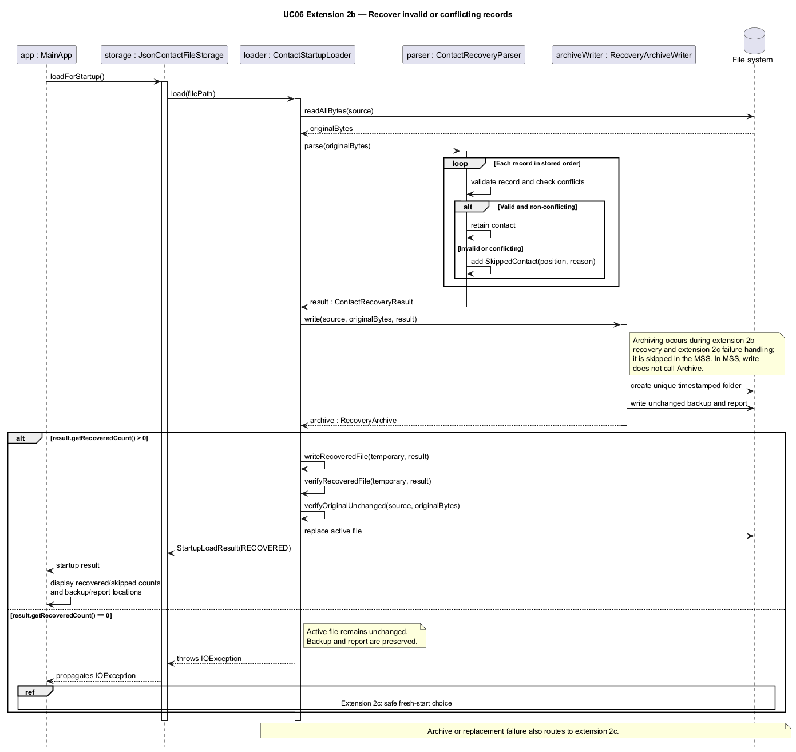

* 2c. The contact file cannot be read or reliably parsed, or recovery cannot
  create its backup/report or safely replace the active file.
    * 2c1. If Astra can read the failed contact file, it preserves its exact bytes
      in a uniquely named incident folder under `data/reports` and writes a failure report.
    * 2c2. Astra shows the error, confirms where the original file is preserved,
      and offers **Start anew** or **Exit**. Exit is the default choice.
    * 2c3. If the user chooses Start anew, Astra verifies the backup and checks
      that the active file has not changed, then atomically replaces it with an
      empty contact file and opens the command interface. The original backup remains unchanged.
    * 2c4. Astra shows an empty contact list and reminds the user of the backup and report locations.

    * 2c2a. The original file cannot be read or safely preserved under reports.
        * 2c2a1. Astra explains that starting anew is unavailable and stops without clearing the contact file.
    * 2c2b. The user chooses Exit or dismisses the dialog.
        * 2c2b1. Astra stops without replacing the active file.
    * 2c3a. Backup verification or atomic replacement fails, or the active file changes.
        * 2c3a1. Astra shows the failure and available archive locations and stops without opening the command interface.

      Use case ends.

* 2d. Another Astra instance is already using the contact file.
    * 2d1. Astra shows that the storage is in use and the second instance stops.

      Use case ends.

**Use case: UC07 - Find contacts by company or role**

**MSS**

1. User enters a company search, role search, or combined company-and-role search.
2. Astra validates the search criteria.
3. Astra displays the matching contacts.
4. User selects a contact using its displayed index.
5. Astra displays the selected contact's details.
   Use case ends.

**Extensions**

- **1a.** No search value is provided.
  - Astra displays the accepted command format.
  - Use case ends.

- **3a.** No contacts match the search criteria.
  - Astra reports that no matching contacts were found.
  - Use case ends.

- **3b.** Both company and role are specified.
  - Astra displays only contacts matching both criteria.
  - Use case resumes at step 4.

**Use case: UC09 - Record and retrieve contacts by event**

**MSS**

1. User adds an event while creating or editing a contact.
2. Astra validates and stores the event with the contact.
3. User enters `find /event EVENT`.
4. Astra displays contacts associated with the event.
5. User selects a displayed contact.
6. Astra displays the contact's stored details and events.
   Use case ends.

**Extensions**

- **1a.** The event name is missing or blank.
  - Astra displays the accepted command format.
  - Use case ends.

- **2a.** The event value is invalid.
  - Astra rejects the command and leaves the contact unchanged.
  - Use case ends.

- **4a.** No contacts are associated with the event.
  - Astra reports that no matching contacts were found.
  - Use case ends.

**Use case: UC21 - Star and retrieve important contacts**

**MSS**

1. User requests to star a contact.
2. Astra marks the contact as starred and saves the change.
3. User later requests the starred contact list.
4. Astra displays all starred contacts.

   Use case ends.

**Extensions**

* 1a. The contact is already starred.
    * 1a1. Astra reports that the contact is already starred and makes no changes.

      Use case ends.

* 1b. User requests to remove a contact's star.
    * 1b1. Astra removes the star, saves the change and displays the updated status.

      Use case ends.

* 4a. No contacts are starred.
    * 4a1. Astra reports that there are no starred contacts.

      Use case ends.

**Use case: UC16 - Record a follow-up action**

**MSS**

1. User enters `followup INDEX a/DESCRIPTION` for a displayed contact.
2. Astra validates and trims the description, resolves the displayed contact,
   and checks its pending actions for the identical description.
3. Astra appends a new action with the next stable ID and `PENDING` status.
4. Astra saves once and displays the updated ordered action list in feedback
   and the contact card, preserving the active contact filter.

   Use case ends.

**Extensions**

* 1a. The index or format is invalid, the description is blank, or an unsupported
  prefix is supplied: report the error without modifying or saving contacts.
* 2a. An identical pending action exists: show it and ask "Add another?".
    * 2a1. User replies y: resume at step 3 with the retained contact/description.
    * 2a2. User replies n/cancel: discard the request and preserve data/view.
    * 2a3. Any other reply: repeat the prompt and perform no save or command.
* 2b. Only a completed action has that description: proceed without a prompt.
* 3a. No further positive integer IDs are available: report the error without
  renumbering or changing the history.
* 4a. Saving fails: restore previous file/model/history/view, clear any pending
  request, and report the failure. A retry requires a new request.

**Notes**

Duplicate confirmation uses an interactive y/n reply rather than a confirmation
suffix on the command, so the user does not have to retype the command. IDs,
completed status, and history storage support UC17. Creation accepts an optional
`d/DATE` before or after `a/DESCRIPTION`, in ISO, day/month/year, or English abbreviated-month format. Dates
display in ISO format with an overdue indicator for pending actions due before
today. Duplicate confirmation retains the requested date and creates a separate
action. Completion and reopening (UC17), editing and deletion have separate commands;
links to events remain outside UC16.

**Use case: UC17 - Complete or reopen a follow-up action**

**MSS**

1. User requests to complete a pending follow-up of a displayed contact, giving its ID.
2. Astra marks the action as completed, keeping its ID, description, due date and position.
3. Astra saves the change and shows the updated action, which now appears only in the completed follow-ups view.

   Use case ends.

**Extensions**

* 1a. The index or format is invalid: report the usage without modifying or saving contacts.
* 1b. The contact has no follow-up with that ID: report the error without saving.
* 1c. User requests to reopen a completed action instead: Astra marks it as
  pending, and it reappears in the pending follow-ups (with `[OVERDUE]` if its
  due date is before today).
    * 1c1. Another pending action of the contact has the same description:
      report the conflicting ID without saving.
* 2a. The action already has the requested status: report it without saving.
* 3a. Saving fails: restore the previous status, file and view, and report the failure.

**Use case: UC11 - Edit a logged interaction**

**MSS**

1. User requests to change the date and/or note of an entry in a contact's interaction history.
2. Astra replaces the entry, keeping the history in date order.
3. Astra saves the change and shows the entry's new number and the updated history.

   Use case ends.

**Extensions**

* 1a. The format is invalid, neither a date nor a note is given, the date is in the future, or the note is
  blank: report the error without modifying or saving contacts.
* 1b. The name matches several contacts: list them and change nothing.
* 1c. The contact has no entry with that number: report how many entries it has, without saving.
* 2a. The edit leaves the entry unchanged, or makes it the same as another entry: report it without saving.
* 3a. Saving fails: restore the previous history, file and view, and report the failure.

**Use case: UC12 - Review follow-ups**

**MSS**

1. User enters `followups`, optionally adding `overdue`, `today`, `upcoming`, `completed` or `undated`.
2. Astra retrieves actions across all stored contacts, including contacts hidden by a contact filter,
   and applies the selected status or date filter. The default view includes pending actions only.
3. Astra displays numbered entries with the contact name, stable action ID,
   description, status and due date. Dates sort ascending; equal dates retain
   contact order and stored action order. Pending actions due before today are
   marked `[OVERDUE]`.
4. User enters a displayed row number.
5. Astra displays the selected action's details and its associated contact.
   Use case ends.

**Extensions**

* 1a. An unknown selector or extra arguments: reject the command and display usage instructions.
* 2a. No matching actions remain: show an empty message for the selected view.
* 3a. Undated actions: list them after dated actions with `No due date`.
* 4a. Invalid numeric reply: repeat the retained list and selection instructions.
* 4b. User enters `n` or `cancel`: clear the request without changing data.
* 4c. Selected contact or action history changed or the contact was deleted:
  clear the request and ask the user to run `followups` again.
* 4d. Non-number input: clear selection and parse/execute the input as a normal
  command. Invalid commands show their normal errors and leave selection closed.

**Implementation and scope**

`ModelManager.getFollowUps()` returns an unmodifiable, sorted snapshot of all actions paired
with their contacts as `FollowUpEntry` records. The pending-only query reuses this snapshot.
The command applies `FollowUpFilter` using one local date from its clock per execution.
Completed includes all completed actions; undated includes only pending actions without dates.
Upcoming has no upper date limit; date views exclude undated and completed actions.
The default view includes all pending actions. Filtered snapshots retain
the existing order. The command uses the shared formatter, preserves the contact filter and
never saves data. A nonempty list returns a `FollowUpSelectionRequest`, which
copies entries in displayed order. Logic retains it through the existing
pending-request flow. Valid replies call `ViewCommand.forPerson` with the selected contact,
then attach the selected action using `CommandResult.withSelectedFollowUp`. This reuses the
normal contact-view result without another name/index lookup or a contact-filter change.
Invalid numeric replies keep the same request.
Non-number replies are dispatched through the normal command parser by Logic,
after clearing the selection request. Other pending requests retain their existing
reply handling, including confirmation prompts.
Selection verifies that the captured contact still exists with the same data.
The UI lists the entries in `FollowUpListPanel` and displays the selected
contact and action in `PersonDetailsPanel`, while retaining the contact filter. Running the list again retrieves current results. Requests are held
only in memory and do not survive restart.

The selection request declares itself read-only. Logic captures the current
model before each reply instead of reusing the pre-prompt transaction snapshot,
so cancellation or stale-selection errors cannot undo intervening changes.
Selection does not save those intervening changes either. The detail result
retains the contact and optional selected action as separate data. The UI renders
contact details through the same path as `view`, including field-order refreshes, and
shows the selected action alongside them without duplicating contact presentation.

**Use case: UC20 - Filter contacts by tags**

**Precondition:** Tags can be assigned using add/edit.

**MSS**

1. User enters `filter t/TAG [t/TAG]...`, optionally choosing `mode/and` or `mode/or`.
2. Astra validates every tag and the single mode, defaulting to AND.
3. Astra displays all stored contacts with every requested tag for AND, or at
   least one requested tag for OR, in their original stored order.
4. User may enter `view INDEX` to inspect a filtered result or `list` to restore
   all contacts. These queries do not modify or save contact data.

   Use case ends.

**Extensions**

* 1a. No tag is supplied: show the accepted format and preserve the prior view.
* 2a. A tag is invalid, a mode is empty/unknown/repeated, or the command has
  malformed extra input: report the error and preserve data and the prior view.
* 2b. The same tag is repeated: match it once without duplicate result entries.
* 3a. No contacts match: display an empty list with an explicit no-match message.
  A later filter searches all stored contacts; `list` restores everyone.
* 4a. The index is outside the filtered results: report an invalid index and
  preserve the filter.

**Notes**

OR matching is offered alongside AND matching. Tag names preserve existing
case-sensitive equality; mode values ignore case. Mixed expressions, contact
sorting, and changing tag validation are outside this use case.

**Use case: UC26 - Reorder displayed contact information**

**MSS**

1. User enters `order` to inspect the current global field order.
2. User supplies every supported field exactly once in the desired order.
3. Astra validates the permutation and updates the global preference.
4. Astra saves preferences atomically and immediately refreshes cards and any
   viewed contact details, retaining the current contact list and filter.

   Use case ends.

**Extensions**

* 2a. A field is unknown, repeated, or missing: show accepted fields and preserve
  the existing preference, data, and view. Field names ignore letter case.
* 3a. The order is unchanged: report that no changes are needed and do not save.
* 4a. Saving fails: preserve the active preference file, restore the previous
  preference and displayed field order, and show the error. Do not write contacts.
* 4b. A contact lacks an optional value: omit that field's row without changing
  the configured order or leaving a blank row.

Old preference files without an order use the default card order, with
follow-ups last. Successful orders persist across restart. UC26 changes field
order; it does not sort contacts alphabetically.

### Non-Functional Requirements

1.  Should work on any _mainstream OS_ as long as it has Java `25` or above installed.
2.  Should hold up to 1000 contacts and respond to any command within 1 second on a typical laptop, so that the user can keep up while meeting people in quick succession.
3.  A user with above average typing speed for regular English text (i.e. not code, not system admin commands) should be able to accomplish most of the tasks faster using commands than using the mouse.
4.  Should work without an internet connection, and should never send contact data over the network.
5. Should store data locally in a human-readable JSON file, without needing a database management system.
6. Changes from a successful command should survive closing and reopening the app. A crash during a save should leave either the complete old file or the complete new file, never a partially written one.
7. Should never silently discard data from a _corrupted contact file_: the original file is backed up before anything is replaced.
8.  Should allow only one running instance to use the contact file at a time.
9.  Should accept names containing non-English (Unicode) letters.
10. Every error message should state what was wrong and, where relevant, the accepted format.
11. Should be packaged as a single JAR file that runs without an installer.

### Glossary

* **Mainstream OS**: Windows, Linux, Unix, or macOS
* **Contact**: A record of one person. Only the name is required. A company, a role, a contact number, an
  email address, a LinkedIn profile and an introducer are each optional and hold at most one value. A contact
  can also have any number of tags, events, follow-up actions and logged interactions
* **Contact number**: A phone number made up of at least three digits, which may also use spaces, hyphens, a leading plus sign for a country code, and balanced parentheses
* **Displayed index**: The number shown beside a contact in the currently displayed list, starting at 1. Commands that take an `INDEX` use it
* **Prefix**: A field marker in a command, such as `c/` for a company or `e/` for an email. Prefixes are case-sensitive
* **Private contact detail**: A contact detail that is not meant to be shared with others
* **Normalisation**: Trimming outer spaces and collapsing repeated spaces before a value is stored or compared
* **Unique key**: A contact number or email. No two contacts may share one
* **Duplicate contact**: An incoming contact whose contact number or email already belongs to an existing contact, or whose name and email identify an existing contact
* **Follow-up action**: A task to do for a contact, with a description, an optional due date, a status (`PENDING` or `COMPLETED`) and an ID that is never reused within that contact
* **Interaction**: A dated note of a conversation or meeting with a contact
* **Pending request**: A prompt that waits for the user's next reply, such as a y/n confirmation or a choice from a numbered list
* **MSS (Main Success Scenario)**: The most common path through a use case, where everything goes as expected
* **CLI (Command Line Interface)**: A text-based interface where the user types commands instead of clicking
* **Candidate list**: The numbered list of matching contacts shown when a name matches several contacts. Indices start at 1
* **Contact file**: The file that stores all contacts, at `data/contactfile.json` in the folder Astra is launched from
* **Corrupted contact file**: A contact file with records that are malformed, have missing fields or invalid values, or conflict with earlier records
* **Backup file**: An unchanged copy of a corrupted contact file, saved as `contactfile.original.json` in a timestamped folder under `data/recovery/` or `data/reports/`, next to a `report.txt`

--------------------------------------------------------------------------------------------------------------------

## **Appendix: Instructions for manual testing**

Given below are instructions to test the app manually. They complement the User Guide, which describes each
command's rules in full, so the steps below give a path through the features and the inputs worth trying
rather than every variation.

:information_source: **Note:** These instructions only provide a starting point for testers to work on;
testers are expected to do more *exploratory* testing.

**Starting from the sample data.** Unless stated otherwise, each section starts from a fresh copy of the
sample data: close Astra, delete the `data` folder next to the JAR file, and launch Astra again. Delete
`preferences.json` too if you want the default field order and no shortcuts. The six sample contacts are, in
order: 1 Alex Yeoh, 2 Bernice Yu, 3 Charlotte Oliveiro, 4 David Li, 5 Irfan Ibrahim and 6 Roy Balakrishnan.
Sample follow-up and interaction dates are counted from the day the samples are first loaded.

### Launch and shutdown

1. Initial launch
   1. Copy the JAR file into an empty folder, and run `java -jar contactfile.jar` from that folder. 
      Expected: the GUI opens with the six sample contacts and a welcome message explaining how to clear them.
1. Saving window preferences
   1. Resize the window and move it to a different location. Enter `exit`.
   1. Launch Astra again. 
      Expected: the most recent window size and location are retained.
1. Running a second instance
   1. While Astra is running, launch the same JAR file again from the same folder. 
      Expected: the second instance reports that the contact file is in use and stops. The first is unaffected.

### Adding and editing contacts

1. `add n/Jane Tan` 
   Expected: Jane Tan is added with only a name. Enter it again: rejected as an existing contact.
   `add n/jane tan e/janetan@example.com` is accepted, because the two contacts have different emails.
1. `add n/Sam Lee p/8743 8807` 
   Expected: rejected, because Alex Yeoh already has that number once spaces are ignored.
   `add n/Sam Lee i/sam  lee` is rejected because a contact cannot be their own introducer.
1. `edit 1 p/91234567` 
   Expected: a preview of the change and the resulting contact, with nothing changed yet. Enter `n`: Alex is
   unchanged. Repeat the edit and enter `y`: Alex's phone is updated.
1. `edit 1 c/ r/`, then `y` 
   Expected: Alex's company and role are removed; other details remain.
1. `edit Yu e/alexyeoh@example.com` 
   Expected: rejected, because the email belongs to Alex Yeoh. `edit 1 i/Jane` is rejected with a pointer to
   `introduce`.

### Removing details and recording introducers

1. `drop 1 t/mentor`, then `y` 
   Expected: only the `mentor` tag is removed from Alex; the other tags remain.
   `drop 1 t/nosuchtag` and `drop 1 n/Alex Yeoh` are rejected without changes.
1. `introduce 4 i/Jane Smith` 
   Expected: David Li has no introducer, so Jane Smith is recorded at once.
1. `introduce 1 i/Jane Smith` 
   Expected: Alex already has Bernice Yu as introducer, so Astra asks before replacing. Enter `n`: unchanged.
1. `add n/Alex Tan e/alextan@example.com`, then `introduce Alex i/Roy Balakrishnan` 
   Expected: the two Alexes are listed with indexes. Enter `9`: the list is shown again. Enter `2`: Roy
   Balakrishnan is recorded as Alex Tan's introducer.

### Starring contacts

1. `starred` 
   Expected: Alex Yeoh, Bernice Yu, Irfan Ibrahim and Roy Balakrishnan, in stored order.
1. `list`, then `star 3` 
   Expected: Charlotte Oliveiro is starred. Entering `star 3` again reports that she is already starred.
1. `unstar /email royb@example.com` 
   Expected: Roy Balakrishnan is no longer starred.

### Finding contacts

1. `find yeo` 
   Expected: Alex Yeoh. Part of a name is enough.
1. `find /fuzzy Bernise` and `find /fuzzy Bernise Yu` 
   Expected: Bernice Yu in both cases, despite the misspelling.
1. `find /contact 8743-8807` 
   Expected: Alex Yeoh. `find /contact 8743` reports `Contact not found.`, since partial numbers do not match.
1. `find /email ALEXYEOH@example.com` 
   Expected: Alex Yeoh. Letter case is ignored.
1. `find /company sho`, `find /role engineer`, and `find /company DBS /role Engineer` 
   Expected: Alex Yeoh, Alex Yeoh, and `Contact not found.` respectively.
1. `find /event meetup` 
   Expected: Alex Yeoh, Charlotte Oliveiro and Irfan Ibrahim.
1. `find /notes internship` 
   Expected: Alex Yeoh, with the date and an excerpt of the matching note.
1. `find`, `find /fuzzy` and `find /notes` 
   Expected: an error with the accepted format; the displayed list is unchanged.

### Filtering by tags

1. `filter t/careerfair`, then `filter t/careerfair t/referral` 
   Expected: Alex, Bernice and Roy; then only Bernice and Roy, who have both tags.
1. `filter mode/or t/finance t/data` 
   Expected: David Li and Irfan Ibrahim.
1. `filter t/CareerFair` 
   Expected: an empty list and a no-match message, because tags are case-sensitive.
1. `filter mode/xor t/data`, `filter t/` and `filter mode/and t/data mode/or` 
   Expected: an error each time, with the previous list kept.

### Viewing contacts

1. `view 2` 
   Expected: Bernice Yu's full details, including her interaction history and events, in the detail panel.
1. `find Yu`, then `view Alex Yeoh` 
   Expected: Alex's details, even though the previous search hid him.
1. `add n/Alex Tan e/alextan@example.com`, then `view Alex` 
   Expected: both Alexes are listed with indexes and no prompt appears. `view 2` then shows Alex Tan.
1. `view 0`, `view 99`, and `view n/Alex` 
   Expected: an error each time, with the displayed list kept.

### Deleting contacts

1. `delete 6` 
   Expected: a preview of Roy Balakrishnan and nothing deleted. Enter `list`: the prompt is repeated. Enter `n`:
   nothing changes. Repeat and enter `y`: Roy is deleted and the remaining count is shown.
1. `add n/Alex Tan e/alextan@example.com`, then `delete Alex` 
   Expected: both Alexes are listed with indexes. Enter `2`: a preview of Alex Tan. Enter `y`: only Alex Tan
   is deleted.
1. `delete /contact 9927 2758` 
   Expected: a preview of Bernice Yu. Enter `cancel`: nothing changes.
1. `delete /email lidavid@example.com CHARLOTTE@example.com` 
   Expected: a preview of both David Li and Charlotte Oliveiro. Enter `n`.
   `delete /email lidavid@example.com nobody@example.com` is rejected as a whole, with no preview.

### Undoing changes and viewing history

1. `edit 2 p/90000000`, then `y`, then `undo` 
   Expected: a preview of the edit to be reversed. Enter `y`: Bernice's previous phone number is restored.
   Enter `undo` again: there is nothing to undo.
1. `delete 3`, then `y`, then `undo`, then `y` 
   Expected: Charlotte Oliveiro is restored as the 3rd contact.
1. `add n/Temp Person`, then `undo` 
   Expected: there is nothing to undo, since only edits and deletions can be undone.
1. `history` 
   Expected: the changes above, newest first, with the undone edit and deletion marked `(undone)`.

### Clearing all entries

1. `find Yu`, then `clear` 
   Expected: the prompt counts all six stored contacts, not just the one displayed. Enter `cancel`: every
   contact remains and the `find Yu` results are shown again.
1. `clear`, then `y` 
   Expected: all contacts are removed and `0 contact(s) remaining` is reported. Restart Astra: the list is
   still empty, and no sample data is added.
1. `clear` again, and `clear 3` 
   Expected: nothing to clear; then an error with the accepted format.

### Logging interactions

1. `log 4 nt/Coffee chat about quant roles` 
   Expected: logged with today's date as David Li's 3rd interaction, after his two sample interactions.
1. `log 4 d/1 Jan 2020 nt/Met at an alumni talk` 
   Expected: the interaction becomes number 1, since the history is kept in date order.
   `log 4 d/1999-12-31 nt/x`, a future date, and `log 4 nt/coffee chat about QUANT roles` are rejected.
1. `editlog 4 i/1 nt/Met at an alumni dinner` 
   Expected: entry 1 shows the new note with the same date. `editlog 4 i/1` and `editlog 4 i/99 nt/x` are
   rejected.
1. `unlog 4 i/1` 
   Expected: the entry is shown for confirmation. Enter `y`: it is removed and the history is renumbered.
1. `log David nt/Chat by name` 
   Expected: logged for David Li, and the list shows the contacts matching `David`.

### Recording and managing follow-ups

1. `followup 3 a/Send thank-you note d/2020-01-01` 
   Expected: Charlotte Oliveiro gets `#2 [PENDING] Send thank-you note | Due: 2020-01-01 [OVERDUE]`.
1. `followup 3 a/Send thank-you note` 
   Expected: Astra shows the existing action and asks **Add another?** Enter `n`: nothing is added.
1. `completefollowup 3 i/2`, then `reopenfollowup 3 i/2` 
   Expected: `#2` becomes completed without `[OVERDUE]`, then pending and overdue again. Completing an
   already completed action, or reopening a pending one, is rejected.
1. `editfollowup 3 i/2 d/` 
   Expected: `#2` shows `No due date`. `editfollowup 3 i/2 a/Ask about the next developer community session`
   is rejected, because it would duplicate pending action `#1`.
1. `deletefollowup 3 i/2`, then `y`, then `followup 3 a/Call Charlotte` 
   Expected: `#2` is removed, and the new action gets ID `#3`, never `#2` again.
1. `followup 0 a/x`, `followup 1 a/`, `followup 1 a/x d/2026-02-30` and `followup 1 a/x confirm/yes` 
   Expected: an error each time, with no change.

### Reviewing follow-ups

1. `followups` 
   Expected: pending actions of all contacts, dated ones first by due date, then undated ones. Alex Yeoh's `#1`
   is marked `[OVERDUE]`.
1. `followups overdue`, `followups today`, `followups upcoming`, `followups undated` and `followups completed` 
   Expected: only the matching actions each time, e.g. `undated` lists Bernice Yu's `#2` and David Li's `#2`.
   `followups bogus` is rejected.
1. `followups`, then `2` 
   Expected: the contact and action of the 2nd row are shown in the detail panel. Clicking a row or using the
   arrow keys does the same.
1. `followups`, then `list` 
   Expected: the follow-up list is closed and `list` runs as a normal command.

### Reordering displayed fields

1. `order` 
   Expected: `name tags company role phone email linkedin followups introducer interactions`.
1. `view 1`, then `order phone name tags company role email linkedin followups introducer interactions` 
   Expected: every card and the displayed details show the phone first. The order of contacts is unchanged.
1. `order name`, `order name name tags company role phone email linkedin followups introducer` and
   `order name tags company role phone email linkedin followups introducer interactions extra` 
   Expected: an error listing the accepted fields each time; the order is unchanged.
1. Restart Astra. 
   Expected: the saved order is still used.

### Creating command shortcuts

1. `alias fn find /notes`, then `fn internship` 
   Expected: the result starts with `Ran: find /notes internship` and shows Alex Yeoh.
1. `alias fn list` 
   Expected: rejected, showing what `fn` already runs. `alias /replace fn list` then replaces it, `alias`
   lists it, and `alias /remove fn` removes it.
1. `alias list find` and `alias x y` 
   Expected: rejected, because `list` is a command and `y` is not.
1. Create a shortcut and restart Astra. 
   Expected: the shortcut still works.

### Using the confirmation panel

1. `delete 1` 
   Expected: the confirmation panel shows the preview. Press Tab to reach the buttons and choose **Cancel**:
   the panel closes and nothing is deleted.
1. `edit 1 p/90000001`, then click **Confirm** 
   Expected: the edit is applied, exactly as if `y` had been typed.
1. Make the window as small as it goes, and run `delete 1` again. 
   Expected: the preview wraps and can be scrolled. Enter `n`.

### Saving data

1. Dealing with a missing data file
   1. Close Astra and delete `data/contactfile.json`. Launch Astra. 
      Expected: the sample contacts are shown, as on the first launch.
1. Dealing with a partly corrupted data file
   1. Close Astra. In `data/contactfile.json`, change one contact's `"email"` value to `"not-an-email"`.
      Launch Astra. 
      Expected: the message area reports how many contacts were recovered and that one record was skipped,
      with the paths of the backup and report. Check that `data/recovery/` contains a folder with
      `contactfile.original.json`, an unchanged copy of the edited file, and `report.txt`, which names the
      skipped record and the reason.
1. Dealing with an unreadable data file
   1. Close Astra and replace the whole content of `data/contactfile.json` with `{`. Launch Astra. 
      Expected: **Astra startup failed** is shown with the backup and report paths under `data/reports/`.
      Choose **Exit**: the file is unchanged.
   1. Launch Astra again and choose **Start anew**. 
      Expected: Astra opens with an empty contact list, and the backup remains in `data/reports/`.
1. Dealing with a failed save (macOS or Linux)
   1. While Astra is running, make the `data` folder read-only, e.g. `chmod a-w data`. Enter
      `add n/Save Test`. 
      Expected: an error that the contact file could not be saved, and Save Test is not in the list. Restore
      the permission with `chmod u+w data`.
