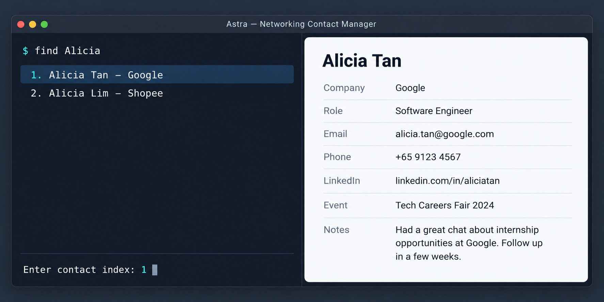

Astra is a **desktop application for managing contacts, optimized for use through a Command Line Interface (CLI)** while retaining the benefits of a Graphical User Interface (GUI). If you type quickly, Astra can help you manage contacts faster than traditional GUI applications.

* Table of Contents
{:toc}

--------------------------------------------------------------------------------------------------------------------

## Quick start

1. Ensure that Java `25` or later is installed on your computer.<br>
   **Mac users:** Ensure you have the precise JDK version prescribed [here](https://se-education.org/guides/tutorials/javaInstallationMac.html).

1. Download the latest `.jar` file from [here](https://github.com/se-edu/addressbook-level3/releases).

1. Copy the file to the folder you want to use as the _home folder_ for Astra.

1. Open a terminal, `cd` to the folder containing the JAR file, and run `java -jar contactfile.jar`.<br>
   A GUI similar to the one below should appear in a few seconds. On first launch, Astra shows sample contacts and a welcome message. Type `clear` to remove the sample contacts when you are ready to add your own.<br>
   

1. Type a command in the command box and press Enter to execute it. For example, type **`help`** and press Enter to open the help window.<br>
   Some example commands you can try:

   * `list` : Lists all contacts.

   * `add n/John Doe c/Acme r/Engineer p/98765432 e/johnd@example.com` : Adds a contact named `John Doe` to the Contact File.

   * `delete 3` : Deletes the 3rd contact shown in the current list.

   * `clear` : Deletes all contacts.

   * `exit` : Exits the app.

1. Refer to the [Features](#features) section below for details of each command.

--------------------------------------------------------------------------------------------------------------------

## Starting Astra

Always launch Astra from the same home folder so it can find your saved contacts in `data/contactfile.json`.

* **No saved contact file:** Astra shows sample contacts and a welcome message explaining how to clear them.
* **Saved contacts load successfully:** The message area shows the number of loaded contacts and the full path to the contact file. A saved empty contact file stays empty.
* **Another Astra instance is using the same contact file:** Startup stops with an error. Close that instance, then launch Astra again.

### Recovering contacts at startup

If the file can be read but contains some invalid or duplicate contacts, Astra automatically keeps the valid contacts and skips the affected records. For duplicate contacts, the first valid record is kept. Recovery proceeds only if at least one valid contact remains.

Before replacing the active file with the recovered contacts, Astra preserves the original file as `contactfile.original.json` and writes a `report.txt` in a separate folder under `data/recovery/`. The startup message shows how many contacts were recovered and skipped, along with the paths to the active file, backup, and report.

Read the report for the positions and reasons for skipped records in the original file. Keep the backup unchanged; use it to look up missing details, correct them, and add those contacts through Astra. Recovery is complete only when Astra displays the successful recovery message.

### When contacts cannot be loaded

If the file is malformed, no valid contacts can be recovered, or recovery cannot finish safely, Astra displays **Astra startup failed** before opening the main window.

When Astra can safely preserve the original contact file, it saves `contactfile.original.json` and `report.txt` in a separate folder under `data/reports/`. The error dialog shows their paths and offers two choices:

* **Start anew:** Replaces the active contact file with an empty one and opens Astra. The startup message confirms the reset and shows the backup and report paths. Keep the backup if you want to restore contact details manually later.
* **Exit:** Closes Astra and leaves the active contact file unchanged. Closing the dialog also exits. You can repair the file or restore a known good backup while Astra is closed, then launch it again.

If Astra cannot safely prepare a reset, **Start anew** is unavailable and the contact file is not cleared. Follow the error message, check that the contact file is readable and its folder is writable, and restart after resolving the problem. If a reset fails, Astra displays an error instead of opening an empty contact file.

--------------------------------------------------------------------------------------------------------------------

## Features

<div markdown="block" class="alert alert-info">

**:information_source: Notes about the command format:**<br>

* Words in `UPPER_CASE` are the parameters to be supplied by the user.<br>
  For example, in `add n/NAME`, replace `NAME` with a value such as `John Doe`.

* Items in square brackets are optional.<br>
  For example, `n/NAME [t/TAG]` can be used as `n/John Doe t/friend` or as `n/John Doe`. For `add`, every field except the name is optional.

* Items followed by `…`​ can appear zero or more times.<br>
  For example, `[t/TAG]…​` may be omitted, or written as `t/friend` or `t/friend t/family`.

* Parameters can be in any order.<br>
  For example, if the command specifies `n/NAME p/PHONE_NUMBER`, `p/PHONE_NUMBER n/NAME` is also acceptable.

* Extraneous parameters for commands that take no parameters, such as `help`, `list`, and `exit`, are ignored.<br>
  For example, `help 123` is interpreted as `help`. `clear` is the exception: it rejects extra parameters instead of ignoring them.

* If you are using a PDF version of this document, be careful when copying and pasting commands that span multiple lines as space characters surrounding line-breaks may be omitted when copied over to the application.
</div>

### Viewing help: `help`

Shows a message explaining how to access the help page.


Format: `help`


### Adding a person: `add`

Adds a person to the contact file.

Format: `add n/NAME [c/COMPANY] [r/ROLE] [p/PHONE_NUMBER] [e/EMAIL] [l/LINKEDIN] [t/TAG]…​`

* Only the name is required. Add whichever details you managed to collect and fill in the rest later with `edit`.

<div markdown="span" class="alert alert-primary">:bulb: **Tip:**
A person can have any number of tags, including zero.
</div>

Examples:
* `add n/John Doe c/Acme r/Software Engineer p/98765432 e/johnd@example.com l/linkedin.com/in/johndoe`
* `add n/Betsy Crowe c/Newgate e/betsycrowe@example.com t/careerfair`
* `add n/Hans Gruber` — just a name, when that is all you got before the conversation moved on.

### Listing all persons: `list`

Shows a list of all persons in the contact file.

Format: `list`

### Editing a person: `edit`

Edits an existing person in the contact file.

Format: `edit INDEX [n/NAME] [c/COMPANY] [r/ROLE] [p/PHONE] [e/EMAIL] [l/LINKEDIN] [t/TAG]…​` or `edit NAME [n/NAME] [c/COMPANY] [r/ROLE] [p/PHONE] [e/EMAIL] [l/LINKEDIN] [t/TAG]…​`

* Edits the person at the specified `INDEX`. The index refers to the index number shown in the displayed person list. The index **must be a positive integer** 1, 2, 3, …​
* Instead of an index, you can give all or part of the person's name, e.g. `edit John Lim p/91234567`. Letter case is ignored.
  * If exactly one person's name contains it, that person is edited.
  * If several do, they are listed with numbers and nothing is edited. Enter the command again with the person's number from that list in place of the name.
* At least one of the optional fields must be provided.
* If every value you enter is the same as the current one, nothing is changed and an error message is shown.
* Existing values will be updated to the input values.
* The new phone number or email must not already belong to another person. Emails are compared without regard to letter case, so `JohnDoe@example.com` and `johndoe@example.com` are the same email.
* When editing tags, all of the person's existing tags are removed; adding tags is not cumulative.
* To remove all of a person's tags, enter `t/` without a tag after it.
* After the edit, each updated field is listed, e.g. `Updated John Lim's phone to 91234567.`

Examples:
*  `edit 1 p/91234567 e/johndoe@example.com` Edits the phone number and email address of the 1st person to be `91234567` and `johndoe@example.com` respectively.
*  `edit 2 n/Betsy Crower t/` Edits the name of the 2nd person to be `Betsy Crower` and clears all existing tags.
*  `edit Betsy p/91234567` Edits the phone number of the person named Betsy, if she is the only person whose name contains `Betsy`.

### Locating persons by name: `find`

Finds persons whose names contain any of the given keywords.

Format: `find KEYWORD [MORE_KEYWORDS]`

* The search is case-insensitive; for example, `hans` matches `Hans`.
* Keyword order does not matter; for example, `Hans Bo` matches `Bo Hans`.
* The search considers only names.
* Only full words match; for example, `Han` does not match `Hans`.
* Persons matching at least one keyword are returned (an `OR` search); for example, `Hans Bo` returns `Hans Gruber` and `Bo Yang`.

Examples:
* `find John` returns `john` and `John Doe`
* `find alex david` returns `Alex Yeoh`, `David Li`<br>
  

### Deleting a person: `delete`

Deletes the specified person from the contact file.

Format: `delete INDEX` or `delete NAME`

* Deletes the person at the specified `INDEX`. The index refers to the index number shown in the displayed person list, and **must be a positive integer** 1, 2, 3, …​
* Instead of an index, you can give all or part of the person's name, e.g. `delete John Lim`. Letter case is ignored, and names are matched the same way `find` matches them.
  * If exactly one person's name contains it, that person is deleted.
  * If several do, they are listed with numbers and **nothing is deleted**. Enter the command again with the person's number from that list in place of the name.
  * Deleting by name searches every contact, not just the ones currently on display, so naming someone reaches them even while a `find` filter is hiding them. Once the person is deleted, the full list is shown again.
* If the first word of your input is a number, it is read as an index rather than as a name. `delete 3` therefore always means "the 3rd person on display".
* If the contact file is empty, Astra reports that there are no contacts to delete and changes nothing.

Examples:
* `list` followed by `delete 2` deletes the 2nd person in the contact file.
* `find Betsy` followed by `delete 1` deletes the 1st person in the results of the `find` command.
* `delete John Lim` deletes John Lim, if he is the only person whose name contains `John Lim`.
* `delete Meier`, with both `Benson Meier` and `Daniel Meier` stored, deletes neither and instead reports:

  ```
  2 contacts found:
  1. Benson Meier — GovTech — johnd@example.com
  2. Daniel Meier — DBS — cornelia@example.com
  To delete one of them, enter the command again with its index in place of the name.
  ```

<div markdown="span" class="alert alert-warning">:exclamation: **Caution:**
`delete` cannot be undone. A confirmation prompt is planned for a later version.
</div>

### Clearing all entries: `clear`

Clears every contact from the contact file and reports how many were cleared.

Format: `clear`

* `clear` takes no parameters. Extra parameters are rejected rather than ignored, so `clear 3` is reported as an invalid command instead of silently clearing everything.
* If the contact file is already empty, Astra reports that there are no contacts to clear and changes nothing.

Examples:
* `clear`, with 12 contacts stored, reports `Cleared 12 contact(s). 0 contact(s) remaining.`
* `clear 3` is rejected, and the accepted command format is shown.

<div markdown="span" class="alert alert-warning">:exclamation: **Caution:**
`clear` cannot be undone. A confirmation prompt is planned for a later version.
</div>

### Exiting the program: `exit`

Exits the program.

Format: `exit`

### Saving the data

Astra automatically saves data after every command. You do not need to save manually.

### Editing the data file

Contact data is saved automatically as a JSON file `data/contactfile.json` in the folder from which you launch Astra (the home folder when following Quick start). Advanced users can edit this file while Astra is closed.

<div markdown="span" class="alert alert-warning">:exclamation: **Caution:**
Back up the file before editing it. On the next launch, Astra may recover valid contacts and skip invalid or duplicate records, or stop with an error and offer **Start anew** if a safe backup can be made. See [Starting Astra](#starting-astra) for the recovery process and backup locations.<br>
Furthermore, certain edits can cause Astra to behave in unexpected ways (e.g., if a value entered is outside of the acceptable range). Therefore, edit the data file only if you are confident that you can update it correctly.
</div>

### Archiving data files `[coming in v2.0]`

_Details coming soon ..._

--------------------------------------------------------------------------------------------------------------------

## FAQ

**Q**: How do I transfer my data to another computer?<br>
**A**: Install the app on the other computer and overwrite the data file it creates with the data file from your previous Astra home folder.

--------------------------------------------------------------------------------------------------------------------

## Known issues

1. **When using multiple screens**, if you move the application to a secondary screen, and later switch to using only the primary screen, the GUI will open off-screen. The remedy is to delete the `preferences.json` file created by the application before running the application again.
2. **If you minimize the Help Window** and then run the `help` command (or use the `Help` menu, or the keyboard shortcut `F1`) again, the original Help Window will remain minimized, and no new Help Window will appear. The remedy is to manually restore the minimized Help Window.

--------------------------------------------------------------------------------------------------------------------

## Command summary

Action | Format, Examples
--------|------------------
**Add** | `add n/NAME [c/COMPANY] [r/ROLE] [p/PHONE_NUMBER] [e/EMAIL] [l/LINKEDIN] [t/TAG]…​` <br> e.g., `add n/James Ho c/Acme r/Analyst p/22224444 e/jamesho@example.com t/colleague`
**Clear** | `clear`
**Delete** | `delete INDEX` or `delete NAME`<br> e.g., `delete 3`, `delete James Ho`
**Edit** | `edit INDEX [n/NAME] [c/COMPANY] [r/ROLE] [p/PHONE_NUMBER] [e/EMAIL] [l/LINKEDIN] [t/TAG]…​`<br> e.g., `edit 2 n/James Lee e/jameslee@example.com`
**Find** | `find KEYWORD [MORE_KEYWORDS]`<br> e.g., `find James Jake`
**List** | `list`
**Help** | `help`
