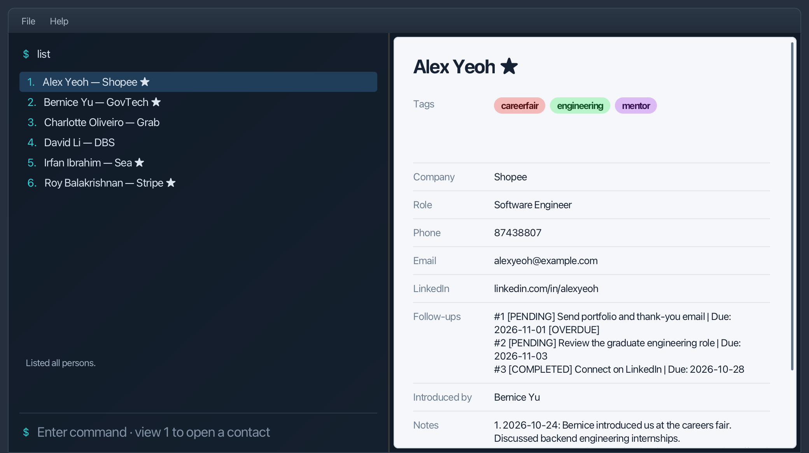

**Astra is a contact book for people who network a lot.** Record the people you meet, what you talked about and what you promised to do next, then find them again before you next meet. You work by typing commands, and Astra shows the results beside each contact's details.

* If you are interested in using Astra, head over to the [_Quick Start_ section of the **User Guide**](UserGuide.html#quick-start).
* If you are interested in developing Astra, the [**Developer Guide**](DeveloperGuide.html) is a good place to start.

**Acknowledgements**

* Libraries used: [JavaFX](https://openjfx.io/), [Jackson](https://github.com/FasterXML/jackson), [JUnit5](https://github.com/junit-team/junit5)
